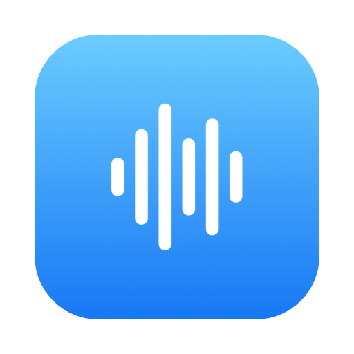
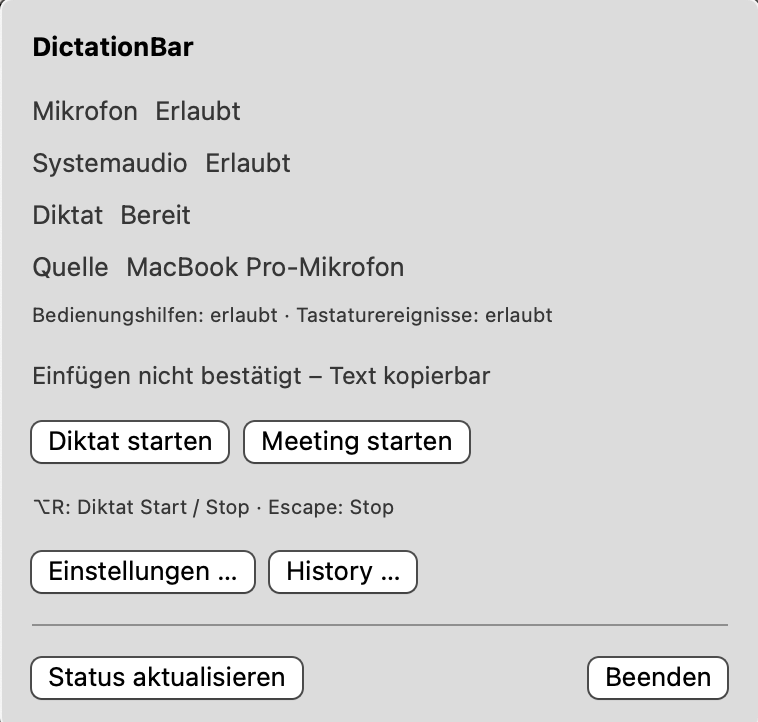

<p align="center"></p>

# DictationBar

Native macOS-Menüleisten-App für persönliches Diktat und Meeting-Aufnahmen. Diktate werden mit dem eigenen Mistral-Key (Voxtral) transkribiert und direkt ins aktive Textfeld eingefügt. Meetings werden aus Systemton und Mikrofon als WAV aufgenommen.



## Funktionen

- **Diktat per Tastenkürzel** (Vorgabe ⌃⌥Leertaste, änderbar): aufnehmen, mit Mistral Voxtral transkribieren, einfügen. Die Zwischenablage bleibt erhalten.
- **Meeting-Aufnahme** (⌃⌥M): Systemton und Mikrofon gemischt in eine WAV, ohne Zeitlimit, ohne Upload.
- **History** aller Aufnahmen mit Text, Kopieren und erneutem Transkribieren.
- **Bluetooth-Mikrofon** wird automatisch bevorzugt, auch während einer laufenden Aufnahme.
- Alle Aufnahmen bleiben als WAV im gewählten Ordner erhalten.

## Voraussetzungen

- macOS 14 oder neuer, Apple Silicon
- Xcode (getestet mit 26.3)
- Eigener [Mistral-API-Key](https://console.mistral.ai/)

## Bauen und installieren

```bash
open DictationBar.xcodeproj   # Schema „DictationBar“, Ziel „My Mac“, ⌘R startet, ⌘U testet
```

Release-Build nach `/Applications`:

```bash
xcodebuild -project DictationBar.xcodeproj -scheme DictationBar -configuration Release \
  -destination 'platform=macOS,arch=arm64' -derivedDataPath build/DerivedData-install build
ditto build/DerivedData-install/Build/Products/Release/DictationBar.app /Applications/DictationBar.app
```

Signiert wird mit dem lokalen, selbst signierten Zertifikat **DictationBar Local Signing**, damit macOS-Freigaben über Builds hinweg gültig bleiben ([Hintergrund](docs/solutions/integration-issues/2026-10-09-adhoc-signing-resets-tcc-and-keychain.md)).

## Einrichten

1. Waveform-Symbol in der Menüleiste öffnen, **Einstellungen …** wählen.
2. Aufnahmeordner und Mikrofon wählen, Mistral-Key eintragen. Der Key liegt nur lokal in `~/Library/Application Support/DictationBar/` (Dateirechte 0600).
3. Mikrofon und Einfügen (Bedienungshilfen) freigeben; beim ersten Meeting fragt macOS nach der Systemaudio-Freigabe.
4. Cursor in ein Textfeld setzen und das Diktat-Kürzel drücken. Dasselbe Kürzel oder Escape beendet.

## Dokumentation

- [PRD](docs/requirements/2026-10-07-prd-draft.md): Anforderungen und detailliertes Verhalten
- [Architekturentscheidung](docs/decisions/001-native-shell-and-services.md)
- [Pläne](docs/plans/), [Prüfberichte](docs/validation/), [Erkenntnisse](docs/solutions/)
- [AGENTS.md](AGENTS.md): Arbeitsweise für Entwicklung mit Agents
