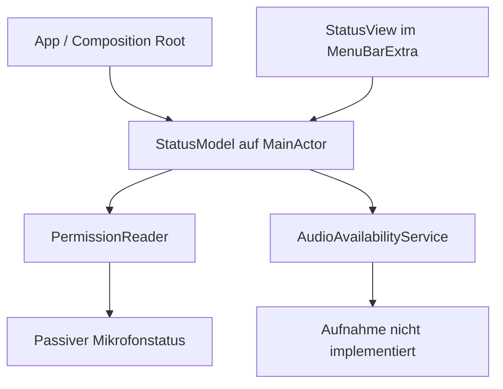
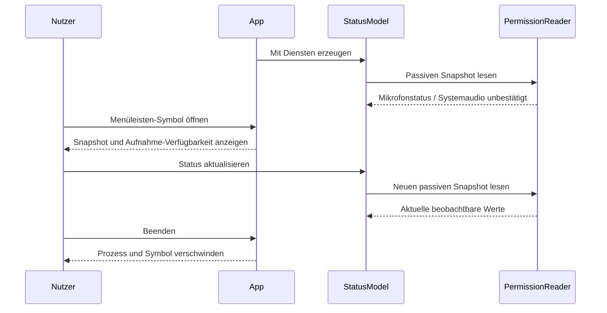

# DictationBar Slice 1 - Plan

## Goal Capsule

- **Objective:** Der Nutzer kann DictationBar auf seinem Mac starten, den verfügbaren Berechtigungsstatus in der Menüleiste ansehen und die App wieder beenden.
- **Means:** Native SwiftUI-App mit injizierbaren Statusdiensten gemäß KTD1–KTD4.
- **Authority:** Das ursprüngliche PRD bleibt die Produktquelle; dieser Plan konkretisiert ausschließlich dessen Slice 1.
- **Execution profile:** Implementierung und Quelltextprüfung können in der Cloud erfolgen; native Builds, XCTest und reale UI-Abnahme erfolgen auf dem Mac.
- **Stop conditions:** Ein fehlschlagender Pflichtcheck oder ein beobachteter automatischer Berechtigungsdialog verhindert die Slice-Abnahme.
- **Completion owner:** Die Implementierung liefert Projekt und Prüfanleitung; der Nutzer führt die Geräteprüfung aus und liefert die Ergebnisse zur Auswertung.

---

## Product Contract

### Summary

Slice 1 liefert das Menüleisten-Grundgerüst mit deutschsprachiger Statusanzeige und passivem Mikrofon-Berechtigungsstatus.
Die Oberfläche benennt die noch nicht geprüfte Systemaudio-Freigabe und die noch nicht implementierte Aufnahme ausdrücklich.

### Problem Frame

Der persönliche Diktat- und Meeting-Ablauf aus dem PRD hat bisher keine startbare Anwendung.
Vor der Arbeit an echten Audiodateien braucht der Nutzer ein überprüfbares App-Grundgerüst, dessen Statusanzeigen keine vorhandenen Funktionen oder Berechtigungen vortäuschen.
Im Repository existieren weder App-Code noch ein Build- oder Testprojekt.

### Requirements

**App und Bedienung**

- R1. Die native Swift-/SwiftUI-App zeigt nach dem Start ein Menüleisten-Symbol. Quelle: PRD §§5, 7 / Slice 1.
- R2. Ein Klick auf das Symbol öffnet die Statusoberfläche; „Beenden“ beendet den App-Prozess. Quelle: PRD §7 / Slice 1.
- R3. Die Oberfläche kennzeichnet Aufnahme als noch nicht verfügbar und ermöglicht keinen Aufnahmebeginn. Quelle: PRD §7 / Slice 1.

**Berechtigungen und Architektur**

- R4. App-Start, Öffnen der Oberfläche und Statusaktualisierung lösen keine Berechtigungsdialoge und keine Aufnahme aus. Quelle: PRD §§4, 7.
- R5. Berechtigungsstatus wird ohne Aufnahme gelesen; die Anzeige behauptet nur Zustände, die die jeweilige macOS-API unterscheiden kann. Quelle: PRD §§4, 7.
- R6. Kleine injizierbare Permission-/Audio-Service-Abstraktionen trennen OS-Zugriff von UI-Zustand auf dem MainActor. Quelle: PRD §§5, 7.

**Abnahme**

- R7. Der native Build und passende Zustands-/Service-Tests bestehen auf dem Ziel-Mac. Quelle: PRD §7 / Slice 1.
- R8. Architekturentscheidung und reale UI-Prüfergebnisse werden im Repository dokumentiert; nicht ausgeführte Prüfungen bleiben ausdrücklich offen. Quelle: PRD §§5, 7, 8.

Die Produktquelle wird unverändert unter dem `origin`-Pfad aufbewahrt.
Dieser Plan führt keine neue Produktfunktion ein.

### Acceptance Examples

- AE1. **Covers R1, R2, R4.** Nach einem Start aus dem App-Bundle erscheint das Symbol; der erste Klick öffnet die Oberfläche ohne Mikrofon- oder Bildschirmaufnahme-Dialog.
- AE2. **Covers R3, R5.** Bei autorisiertem Mikrofon zeigt die App diesen Status; Aufnahme bleibt unverfügbar und Systemaudio wird als „Noch nicht geprüft“ bezeichnet.
- AE3. **Covers R4, R5.** Nach einer externen Freigabeänderung aktualisiert „Status aktualisieren“ den beobachtbaren Mikrofonstatus ohne Aufnahme oder Einwilligungsdialog.
- AE4. **Covers R2, R4.** Nach „Beenden“ verschwinden Prozess und Menüleisten-Symbol; ein erneuter Start verursacht keinen Berechtigungsdialog.

### Scope Boundaries

**Deferred for later:** Die Slices 2–7 des PRD bleiben vollständig erhalten: Mikrofon und WAV, Systemaudio und Mischung, History/Dateiverwaltung, Shortcut, Keychain/Voxtral und Einfügen.
Ihre Datei-, Fokus-, Fehler- und Berechtigungsregeln sowie die Arbeitsannahmen aus PRD §6 werden im jeweils betroffenen Slice behandelt.
Slice 1 legt weder Audioformat noch API-Modell oder Tastenkürzel neu fest.

**Outside this product's identity:** Die Ausschlüsse aus PRD §9 gelten weiter, einschließlich lokaler Whisper-Modelle, automatischer Meeting-Uploads, virtueller Audiotreiber, Accounts und Synchronisierung.

**Considered and not built:** Ein paralleles SwiftPM-Projekt, Projektgenerator, Aufnahme-Zustandsmaschine, Berechtigungsanforderungs-Methoden und automatische Statusüberwachung werden hier nicht angelegt.
Für R1–R8 benötigen sie keinen eigenen Nutzerablauf; echte portable Domänenlogik oder ein späterer Aufnahmeablauf können diese Entscheidung ändern.

---

## Planning Contract

### Assumptions

- Der Arbeitstitel bleibt `DictationBar`; der Repository-Name bleibt `speeechless_macos`.
- Deutschsprachige Oberfläche und Deploymentziel macOS 14.0 werden aus PRD §6 übernommen.
- Projektlayout, Window-Stil und lokale Signierung sind technische Vorschläge für diesen Plan, keine bereits vorhandenen Repository-Konventionen.
- Der lokale Checkout liegt im vom Nutzer gewählten Projektordner; der Plan setzt keinen persönlichen Verzeichnispfad voraus.

### Key Technical Decisions

- KTD1. **Ein natives Xcode-Projekt.** `DictationBar.xcodeproj` erhält ein App-Target, ein gehostetes macOS-XCTest-Target und ein geteiltes Schema `DictationBar` mit Test-Aktion. Es gibt ein explizites `DictationBar/Info.plist`, eine stabile Bundle-ID `com.primocammino.DictationBar` und lokale Ad-hoc-Signierung ohne kostenpflichtiges Developer-Team. Eine zweite Buildbeschreibung würde OS-Integration doppelt verwalten, ohne diese auf Linux ausführbar zu machen. Für R1, R7. Die Entscheidung lässt sich später ohne Datenmigration ändern.
- KTD2. **Eine Composition Root und MainActor-Zustand.** Die App erzeugt einmal einen StatusModel mit injiziertem PermissionReader und AudioAvailabilityService. Die View rendert dessen Snapshot und führt Statusaktualisierung oder Beenden aus. Für R2, R6; keine zusätzliche DI-Bibliothek oder globale Service-Singletons.
- KTD3. **Mikrofon passiv lesen, Systemaudio unbestätigt lassen.** Der native Adapter verwendet ausschließlich `AVCaptureDevice.authorizationStatus(for: .audio)`. Er erhält `notDetermined`, `restricted`, `denied`, `authorized` sowie einen konservativen Fallback für unbekannte Werte. Systemaudio bleibt `notVerified`, angezeigt als „Noch nicht geprüft“. `CGPreflightScreenCaptureAccess` wird nicht als Audio-Freigabe verwendet; auch ein positives Ergebnis beweist nur Bildschirmzugriff. Für R4, R5. Diese Grenze folgt aus den Apple-API-Deklarationen im SDK-Archiv, siehe Sources.
- KTD4. **Nur benötigte Audio-Verfügbarkeit abstrahieren.** Der AudioAvailabilityService meldet `notImplemented`, ohne Capture-Ressourcen anzulegen. Die UI aus R3 richtet ihre Aufnahme-Verfügbarkeit nach diesem Dienst und nicht nach einer Freigabe. Start/Stop, Sessions, Dateiformate und Permission-Requests werden erst bei ihrem tatsächlichen Nutzerablauf entworfen. Für R3, R6.
- KTD5. **Menüleisten-App mit kleinem Statusfenster.** `MenuBarExtra` im Window-Stil zeigt Status, „Status aktualisieren“ und „Beenden“. `LSUIElement` macht die App zur Menüleisten-App ohne regulären Dock-Eintrag. Ein System-Symbol genügt für diesen Slice. Für R1, R2; kein Settings-Fenster oder Aufnahme-Timer.

Die native Implementierung von KTD3 darf keine Geräte-Inputs konstruieren, `requestAccess` ausführen, ScreenCaptureKit-Inhalte enumerieren oder Audio-Engines starten.
Bereits die Konstruktion eines `AVCaptureDeviceInput` kann eine Freigabe anfragen.
Tests nutzen injizierte Werte und prüfen die native Adapter-Zuordnung über eine kleine austauschbare Probe; echte TCC-Aufrufe bleiben der Geräteprüfung vorbehalten.

### High-Level Technical Design

Die Skizzen zeigen Verantwortlichkeiten und den Nutzerablauf; konkrete Typnamen und die interne Datenform können bei der Umsetzung angepasst werden.





### Output Structure

Alle folgenden App-/Testdateien sind geplante Neuzugänge.

```text
DictationBar.xcodeproj/project.pbxproj
DictationBar.xcodeproj/xcshareddata/xcschemes/DictationBar.xcscheme
DictationBar/Info.plist
DictationBar/App/DictationBarApp.swift
DictationBar/UI/StatusView.swift
DictationBar/State/StatusModel.swift
DictationBar/Services/Permissions.swift
DictationBar/Services/NativePermissionReader.swift
DictationBar/Services/AudioAvailabilityService.swift
DictationBarTests/PermissionMappingTests.swift
DictationBarTests/AudioAvailabilityTests.swift
DictationBarTests/StatusModelTests.swift
docs/decisions/001-native-shell-and-services.md
docs/validation/slice-1.md
README.md
.gitignore
```

### Risks and Dependencies

- Der bekannte Ziel-Mac läuft mit macOS 15.7.3 auf `arm64`; Xcode 26.3, Build 17C529, ist ausgewählt und wurde geöffnet. Der tatsächlich installierte Swift-Compiler und die SDK-Deklarationen werden vor dem nativen Build erfasst.
- Die Cloud läuft unter Debian ohne Swift/Xcode/Apple-SDKs oder macOS-GUI. Ein statisch geprüftes Projekt gilt deshalb noch nicht als nativ gebaut.
- Die API-Recherche verwendet Apple-authored SDK-15.5-Deklarationen aus einem Drittanbieter-Archiv. Die Umsetzung prüft die verwendeten Deklarationen zusätzlich im installierten Xcode-SDK; die Apple-Dokumentationswebsite war aus der Cloud mit HTTP 403 nicht erreichbar.
- Derselbe Bundle-Identifier wird bei lokalen Prüfungen beibehalten. Es werden keine globalen TCC-Resets vorgenommen. Wenn die App bereits eine Freigabe hat, bleibt die Beobachtung eines frischen Permission-Zustands als Einschränkung dokumentiert.
- Ein Build mit Deploymentziel 14.0 und ein Lauf unter 15.7.3 belegen keinen realen Lauf auf macOS 14. Dieser zusätzliche Lauf ist für die Abnahme auf dem vorhandenen Ziel-Mac optional.

### Sources

- Produktquelle: `docs/requirements/2026-10-07-prd-draft.md`, insbesondere §§4–8; übrige MVP-Anforderungen bleiben den benannten Folgeslices zugeordnet.
- Mikrofonzustände und Input-Konstruktionswarnung: [Apple-Header im SDK-15.5-Archiv](https://github.com/alexey-lysiuk/macos-sdk/blob/master/MacOSX15.5.sdk/System/Library/Frameworks/AVFoundation.framework/Versions/A/Headers/AVCaptureDevice.h).
- Bildschirm-Preflight als boolesche Bildschirmprüfung: [CoreGraphics-Header im SDK-15.5-Archiv](https://github.com/alexey-lysiuk/macos-sdk/blob/master/MacOSX15.5.sdk/System/Library/Frameworks/CoreGraphics.framework/Versions/A/Headers/CGWindow.h).
- MenuBarExtra und Window-Stil: [SwiftUI-Interface im SDK-15.5-Archiv](https://github.com/alexey-lysiuk/macos-sdk/blob/master/MacOSX15.5.sdk/System/Library/Frameworks/SwiftUI.framework/Versions/A/Modules/SwiftUI.swiftmodule/arm64e-apple-macos.swiftinterface).
- [Apple MenuBarExtra](https://developer.apple.com/documentation/swiftui/menubarextra) ist eine Referenz für die lokale SDK-Prüfung; die Website wurde in dieser Recherche nicht erfolgreich abgerufen.

---

## Implementation Units

### U1. Native project and app bundle

**Goal:** Ein reproduzierbares macOS-App-Bundle mit Test-Infrastruktur bereitstellen.
**Requirements:** R1, R7; KTD1, KTD5.
**Dependencies:** Keine; das Repository hat noch kein App-Projekt.
**Files:** `DictationBar.xcodeproj/project.pbxproj`, `DictationBar.xcodeproj/xcshareddata/xcschemes/DictationBar.xcscheme`, `DictationBar/Info.plist`, `DictationBar/App/DictationBarApp.swift`, `DictationBar/UI/StatusView.swift`, `.gitignore`.
**Approach:** Projekt gemäß KTD1 anlegen und eine minimale, startbare Menüleisten-Oberfläche für die Integration in U3 verdrahten. Build-Ausgaben, Xcode-Benutzerdaten und Result-Bundles werden ignoriert; die vorhandene CE-Beispielkonfiguration bleibt erhalten.
**Patterns:** PRD §5; native Xcode-App mit geteiltem Schema. Es existiert kein Projektmuster im Repository.
**Test scenarios:**

1. Ein lokaler Debug-Build erstellt das App-Bundle ohne Developer-Team; das geteilte Schema führt das App- und XCTest-Target auf.
2. Covers AE1. Der erste Start zeigt das Menüleisten-Symbol; ein Klick öffnet die minimale Oberfläche ohne Berechtigungsdialog.

Separate Konfigurationstests sind nicht erforderlich; diese Szenarien werden am nativen Projekt und App-Bundle geprüft. Die Service-/Zustandstests entstehen in U2/U3.
**Execution note:** Das App-Bundle früh auf dem Mac bauen, bevor die restliche Statusoberfläche erweitert wird.
**Verification:** Das geteilte Schema listet App- und XCTest-Target; die App baut ohne kostenpflichtiges Developer-Team und startet gemäß AE1.

### U2. Passive permission and audio availability services

**Goal:** Wahrheitsgemäße Statuswerte ohne Capture-Nebenwirkungen liefern.
**Requirements:** R3–R6; KTD3, KTD4; AE2.
**Dependencies:** U1.
**Files:** `DictationBar/Services/Permissions.swift`, `DictationBar/Services/NativePermissionReader.swift`, `DictationBar/Services/AudioAvailabilityService.swift`, `DictationBarTests/PermissionMappingTests.swift`, `DictationBarTests/AudioAvailabilityTests.swift`.
**Approach:** Die aktuellen Schnittstellen und Werte nach KTD3/KTD4 definieren; die native Statusprobe bleibt von der Zuordnung und den Tests austauschbar getrennt. Die deutsche Darstellung bezeichnet den nicht bestimmten Mikrofonstatus als „Noch nicht angefragt“ und den Systemaudiozustand als „Noch nicht geprüft“.
**Patterns:** Apple-API-Deklarationen aus Sources; keine gemeinsame vierstufige OS-Permission-Enumeration für Mikrofon und Systemaudio.
**Test scenarios:**

1. Jeder der vier bekannten Mikrofon-Probewerte ergibt die entsprechende Statusdarstellung; ein unbekannter Wert ergibt „Unbekannt“ statt freigegeben.
2. Covers AE2. Ein autorisierter Mikrofonwert bestätigt keinen Systemaudio-Status.
3. Der Audio-Dienst liefert unabhängig von Mikrofonwerten die unverfügbare Aufnahme mit dem Grund `notImplemented`.
4. Konstruktion und wiederholtes Lesen der Statusdienste verwenden ausschließlich passive Probes; die Implementierung enthält keine der in KTD3 ausgeschlossenen Capture-/Request-Operationen.

**Verification:** Die beiden XCTest-Dateien führen echte Testfälle aus; die Produktionsadapter-Zuordnung ist geprüft, nicht nur ein fertig vorbereiteter Fake-Snapshot.

### U3. Status UI and app composition

**Goal:** Die Statusdienste in der echten Menüleisten-Oberfläche verwenden.
**Requirements:** R1–R6; KTD2, KTD5; AE1–AE4.
**Dependencies:** U1, U2.
**Files:** `DictationBar/State/StatusModel.swift`, `DictationBar/UI/StatusView.swift`, `DictationBar/App/DictationBarApp.swift`, `DictationBarTests/StatusModelTests.swift`.
**Approach:** Die vorhandene Shell mit der einmaligen Composition Root aus KTD2 verbinden. Statusaktualisierung übernimmt einen neuen Snapshot; das Öffnen/Schließen des Fensters erzeugt keine neue Service-Instanz. Der Beenden-Befehl beendet die macOS-App.
**Patterns:** MainActor für sichtbaren Zustand gemäß R6; View und Tests verwenden dieselbe Statusdarstellung.
**Test scenarios:**

1. Covers AE2. Modellinitialisierung mit autorisiertem Mikrofon zeigt verfügbare Statusinformation, jedoch keine verfügbare Aufnahme.
2. Covers AE3. Ein Fake-Wechsel von nicht bestimmt zu autorisiert wird bei Aktualisierung sichtbar; Systemaudio bleibt unbestätigt.
3. Wiederholte Aktualisierung liest die aktuellen Probewerte und erzeugt weder einen neuen Audio-Dienst noch einen Aufnahmezustand.
4. Gesperrte, abgelehnte und unbekannte Mikrofonwerte bleiben unterscheidbar; die UI-Modellwerte spiegeln sie nach einer Aktualisierung wider.
5. Die App-Komposition wird zusätzlich durch AE1 und AE4 am realen App-Bundle geprüft; Fakes ersetzen diesen Nachweis nicht.

**Verification:** StatusModel-XCTest besteht; die Geräteprüfung bestätigt Menüöffnung, lesbare deutsche Statusanzeige, Aktualisierung und Beenden ohne Dialoge.

### U4. Architecture decision and native acceptance evidence

**Goal:** Die Implementierung und ihre tatsächliche Abnahme für spätere Slices nachvollziehbar machen.
**Requirements:** R7, R8; alle AE-IDs.
**Dependencies:** U1–U3.
**Files:** `docs/decisions/001-native-shell-and-services.md`, `docs/validation/slice-1.md`, `README.md`.
**Approach:** Die gewählten KTDs in einer kurzen Architekturentscheidung festhalten. README dokumentiert konkrete Build-, Test- und App-Startbefehle für das tatsächlich erzeugte Schema. Der Prüfbericht unterscheidet bestandene, fehlgeschlagene und nicht ausgeführte Checks gemäß Verification Contract.
**Test expectation:** Keine Tests nur für Dokumentation; die vorhandenen nativen Checks liefern die Evidenz.
**Verification:** Der Nutzer kann das Projekt in seinem gewählten Checkout bauen und starten; der Prüfbericht enthält die tatsächlich beobachteten Ergebnisse und verbleibenden Grenzen.

---

## Verification Contract

Die folgenden Checks sind geplante Abnahmebedingungen, keine bereits ausgeführten App-Prüfungen.
Das Repository enthält zum Zeitpunkt dieses Plans noch kein App-Projekt und keine XCTest-Dateien.

| Check | Ort | Pflicht | Erfolgssignal |
|---|---|---|---|
| Projekt-/Schema-/Plist- und Quelltextprüfung | Cloud | Ja | App-/Testdateien und geteiltes Schema sind vollständig; KTD3 verbotene Request-/Capture-Pfade fehlen |
| Schema-Ermittlung und Debug-Build | Mac, Xcode 26.3 | Ja | `xcodebuild -list` erkennt das erzeugte Projekt und Schema; dessen Build erstellt `DictationBar.app` mit Deploymentziel 14.0 |
| PermissionMapping-, AudioAvailability- und StatusModel-XCTest | Mac | Ja | Alle vorgesehenen Testfälle laufen tatsächlich und bestehen; null ausgeführte Tests gelten als Fehler |
| Menüleisten-/Dialog-/Beenden-Prüfung AE1, AE4 | Mac | Ja | Launch, Öffnen, Aktualisieren, Beenden und Neustart sind ohne unerwartete Dialoge beobachtet |
| Status-/Freigabe-Prüfung AE2, AE3 | Mac | Ja, soweit Zustand reproduzierbar | Tatsächliche Mikrofonzustände sind korrekt; unzugängliche Freigabezustände werden als nicht geprüft dokumentiert |
| Lauf auf macOS 14 | Weiterer Mac | Optional | Tatsächlicher Lauf dokumentiert; ein erfolgreicher 15.7.3-Lauf wird nicht als Nachweis ausgegeben |

Native Prüfläufe erfassen Betriebssystem, Architektur, Xcode-/Swift-Version, geprüften Commit oder Diff-Stand und Testanzahl.
Build-/Testprotokolle bewahren den tatsächlichen Exit-Code; neue Ergebnis-Bundles erhalten einen neuen Pfad, statt alte Evidenz zu löschen.
Kein erfolgreicher Cloud-Check ersetzt R7 oder die reale UI-Prüfung aus R8.
Der mitgelieferte `ce-test-xcode`-Skill richtet sich an iOS-Simulatoren; er wird nicht als macOS-Prüfung verwendet.

---

## Definition of Done

- U1–U4 erfüllen die ihnen zugeordneten Anforderungen; R1–R8 sind auf dem vorhandenen Ziel-Mac nachgewiesen.
- KTD3 bewahrt die Unsicherheit beim Systemaudio-Status; AE1–AE4 sind anhand echter App-Beobachtungen dokumentiert, mit benannten nicht reproduzierbaren Permission-Zuständen.
- Pflicht-Build und XCTest sind erfolgreich; eine offene native UI-Prüfung verhindert die vollständige Slice-Abnahme.
- Architekturentscheidung, README und Prüfbericht entsprechen der tatsächlichen Implementierung.
- Experimente und ungenutzte Ansätze sind aus dem App-Diff entfernt; keine Secrets oder Build-/Benutzerdaten werden versioniert.
- Die Slices 2–7 beginnen erst nach der Abnahme dieses Slices gemäß PRD §8.
