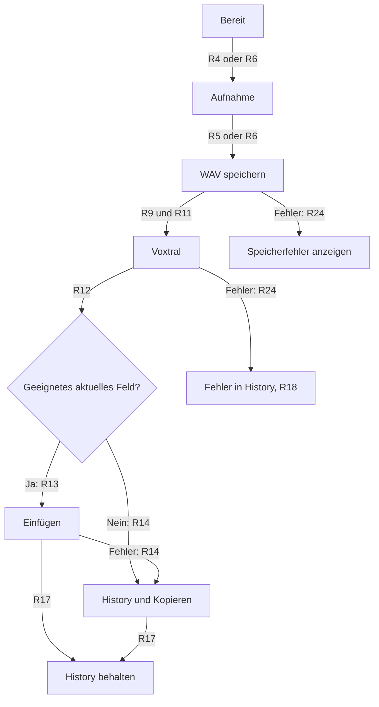
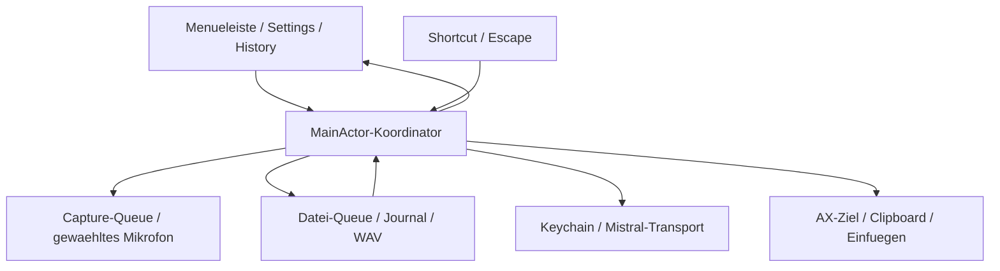
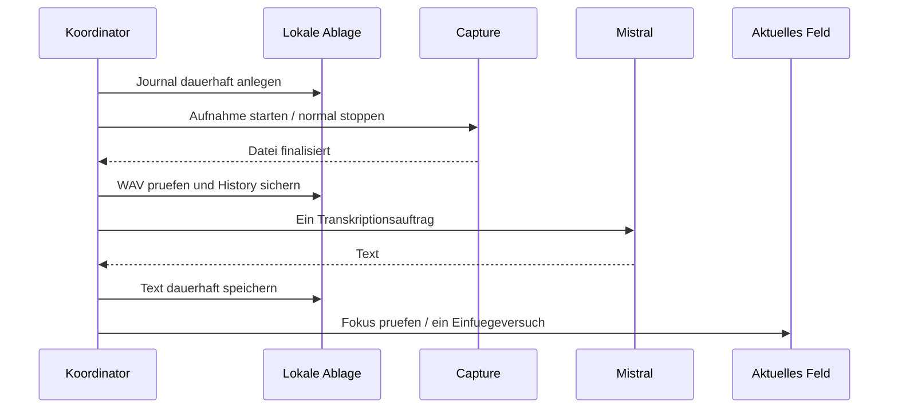
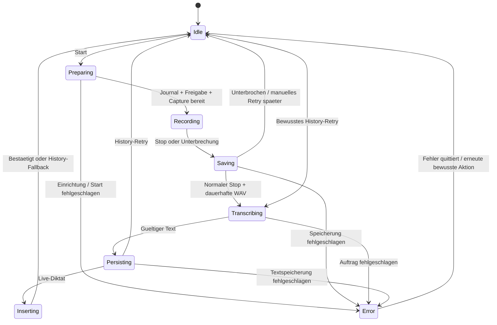
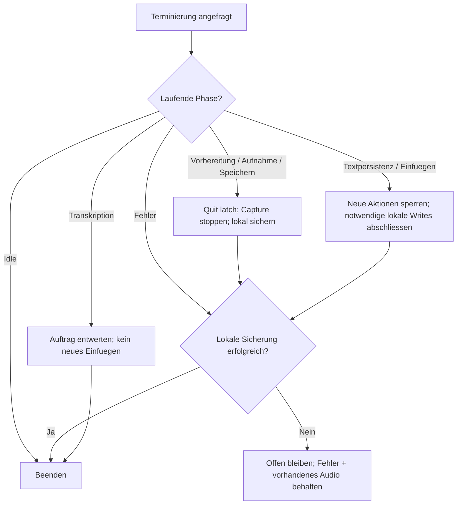
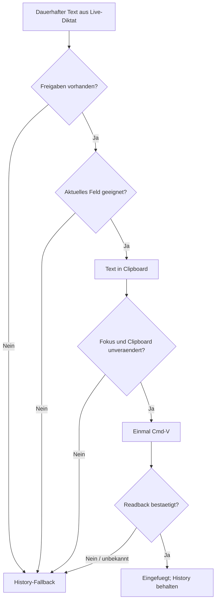
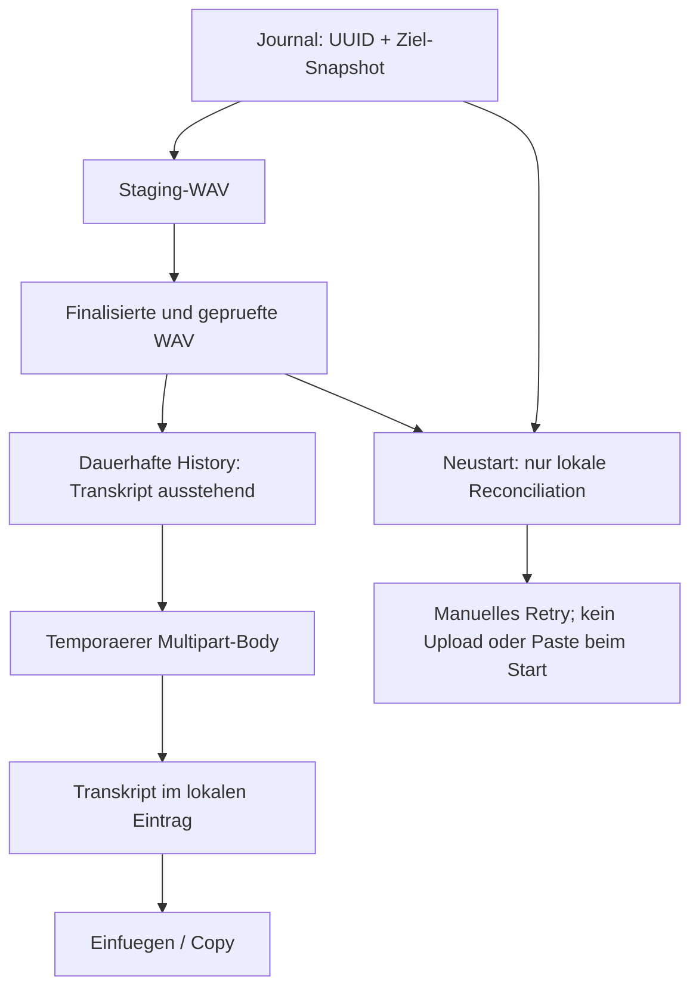
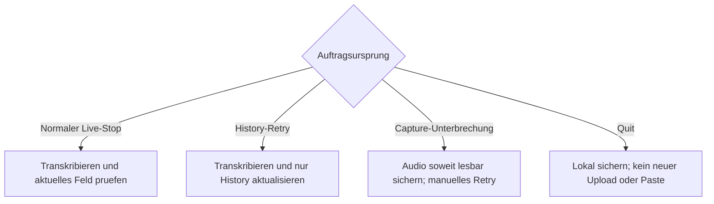

# Slice 2: Diktat mit Voxtral und History - Plan

> **Anforderungsänderung vom 09.10.2026:** Der Nutzer verlangt zusätzlich einen Aufnahmehinweis bei Browser-Audio und automatische Bluetooth-Mikrofonwahl. [PRD, Abschnitt 11](../requirements/2026-10-07-prd-draft.md#11-ergänzungen-browser-aufnahmehinweis-und-bluetooth-mikrofon) hält die neuen Anforderungen fest, einschließlich des bestätigten sofortigen Bluetooth-Mikrofonwechsels während laufender Aufnahme (BT3). Das widerspricht dem bisherigen festen Mikrofon-Snapshot; die Umsetzungseinheiten und Capture-Mechanik müssen dafür angepasst werden. Die bisherigen R-/KTD-/U-Einheiten beschreiben den implementierten Slice-2-Stand; diese Ergänzungen sind darin noch nicht geplant, implementiert oder abgenommen. Bei betroffenen Entscheidungen geht die aktuelle Nutzeranweisung vor.

## Goal Capsule

- **Objective:** Der Nutzer kann per Tastenkürzel diktieren und erhält den Text im aktiven Eingabefeld oder zuverlässig aus der History.
- **Product authority:** Dieser bestätigte Slice-2-Umfang hat bei Konflikten Vorrang vor dem [PRD vom 07.10.2026](../requirements/2026-10-07-prd-draft.md). Die konkreten Änderungen stehen unter Key Decisions und How This Work Fits Together.
- **Means:** Native AVFoundation-Aufnahme, dauerhafte lokale History, Mistral-Dateitranskription und einmaliger Einfügevorgang über die Zwischenablage (KTD2–KTD7).
- **Execution profile:** Ausschließlich lokale Umsetzung und native macOS-Prüfung gemäß R26; Mistral-Aufrufe gehören zur bewusst genutzten Produktfunktion gemäß R27.
- **Authority:** Nutzeranweisung vor Product Contract; R-IDs besitzen das Produktverhalten, KTDs den technischen Mechanismus, U-IDs die Umsetzung.
- **Stop conditions:** Nicht sicherbare Aufnahme, nicht erfüllbarer Shortcut/Escape oder fehlender echter Transkriptions-/Einfügenachweis verhindern die Abnahme; Grenzen werden sichtbar dokumentiert.
- **Tail ownership:** Implementierung und lokale Prüfung sind gemeinsam abzuschließen. Ohne erfüllte Verification Contract und Definition of Done ist Slice 2 nicht abgenommen.

---

## Product Contract

### Summary

Slice 2 liefert ein nutzbares Diktat vom globalen Tastenkürzel bis zum eingefügten Text.
Mistral Voxtral übernimmt die Transkription mit dem eigenen API-Key des Nutzers.
Eine dauerhafte History hält Aufnahmen und Ergebnisse für den manuellen Zugriff bereit.
Das bestehende native Grundgerüst wird um diese Funktionen erweitert; TextEdit und Safari bilden die erste reale Einfüge-Prüfung.

### Problem Frame

Slice 1 zeigt bislang nur Berechtigungs- und Verfügbarkeitsstatus.
Der Nutzer benötigt ein Diktat, dessen Text auch bei verlorenem Fokus oder einer fehlgeschlagenen Online-Verarbeitung wieder erreichbar bleibt.

### Key Decisions

- **Ein vollständiger Diktierablauf in Slice 2.** Governs R4–R8, R11–R18. (session-settled: user-directed — chosen over microphone-to-WAV only: delivers the user's usable dictation workflow now, with a larger implementation and validation scope.)
- **Voxtral mit BYOK.** Governs R10–R11. (session-settled: user-directed — chosen over fully offline transcription: the user wants Mistral Voxtral and supplies their own key.)
- **Aktuelles Eingabefeld als Ziel.** Governs R12–R14. (session-settled: user-directed — chosen over the originally focused field: insertion follows the field focused when transcription finishes.)
- **Beenden mit gesicherter Aufnahme.** Governs R19–R20. (session-settled: user-directed — chosen over blocking Quit until processing finishes: the app can close while keeping unfinished work recoverable.)
- **Ein Diktat nach dem anderen.** Governs R8. (session-settled: user-approved — chosen over overlapping dictation runs: finish the current result before accepting another recording.)
- **Transkript bleibt in der Zwischenablage.** Governs R28. (session-settled: user-directed — chosen over preserving the previous clipboard contents: the user approved normal paste with the transcript remaining available.)
- **Lokale Aufnahme vor der Online-Verarbeitung.** Governs R9, R11, R18, R23–R24; eine gespeicherte WAV bleibt auch ohne erfolgreiches Transkript verwendbar.

<!-- ce-section: work-relationships -->
### How This Work Fits Together

Dieser Plan besitzt den vollständigen persönlichen Mikrofon-Diktierablauf.
Die folgenden Beziehungen beschreiben die aktuelle Aufteilung, keine unveränderliche Roadmap.

- **Depends on:** Das lokal abgenommene Slice-1-Grundgerüst; [Prüfbericht](../validation/slice-1-local-2026-10-09.md).
- **Integrates:** Die bisher für Slices 4–7 vorgesehenen Grundfunktionen History, Shortcut, BYOK/Voxtral und Einfügen werden für diesen Diktierablauf vorgezogen.
- **Shares:** Spätere Aufnahmearten können die dauerhafte WAV-Ablage und History weiterverwenden.
- **Deferred:** Systemaudio und Meeting-Aufnahmen sowie zusätzliche Dateiverwaltung und integrierte Wiedergabe bleiben außerhalb dieses Plans.

Die bisherigen PRD-Regeln für bewusst manuell ausgelöste Diktat-Transkription und das ursprünglich aktive Einfügeziel werden für diesen Ablauf durch R11 und R12 ersetzt.
Die übrigen PRD-Leitplanken bleiben gültig, soweit sie diesem Plan nicht widersprechen.

### Actors

- A1. Nutzer: richtet Mikrofon, Speicherort und eigenen Mistral-Key ein und diktiert in anderen Apps.
- A2. DictationBar: nimmt auf, sichert Dateien, führt die Transkription aus und verwaltet die History.
- A3. Mistral: verarbeitet die bewusst gestarteten Diktate über Voxtral unter dem Konto des Nutzers.
- A4. Ziel-App: stellt das zum Einfügezeitpunkt fokussierte Eingabefeld bereit.

### Requirements

**Aufnahme und Bedienung**

- R1. Die App bleibt eine deutschsprachige native macOS-Menüleisten-App mit einem sichtbaren Zugang zu Aufnahme, Einstellungen und History.
- R2. Der Nutzer kann ein verfügbares Mikrofon auswählen, das für die Aufnahme tatsächlich verwendet wird.
- R3. Der Nutzer kann den WAV-Zielordner wählen; die Ordnerwahl bleibt nach einem App-Neustart erhalten.
- R4. Ein globales Tastenkürzel startet die Mikrofonaufnahme auch dann, wenn eine andere App aktiv ist.
- R5. Dasselbe Tastenkürzel oder Escape stoppt eine laufende Aufnahme und führt sie dem normalen Diktierablauf zu.
- R6. Start und Stop bleiben zusätzlich über die App bedienbar.
- R7. Aufnahme, Speicherung und Transkription sind als unterscheidbare Zustände sichtbar, ohne die Oberfläche zu blockieren.
- R8. Ein neuer Diktierlauf kann erst nach Abschluss oder einem angezeigten Fehler des vorherigen Laufs starten; weitere Startaktionen während der Verarbeitung erzeugen keine Warteschlange.
- R9. Eine Aufnahme wird als kollisionssichere, abspielbare WAV dauerhaft gespeichert; „gespeichert“ darf erst nach erfolgreichem Abschluss der Datei angezeigt werden.

**BYOK und Transkription**

- R10. Der Nutzer kann seinen eigenen Mistral-API-Key im macOS-Schlüsselbund hinterlegen, ändern und entfernen; der Key erscheint weder in History noch in Logs oder Versionsverwaltung.
- R11. Nach einem normalen Stop gemäß R5 oder R6 wird die erfolgreich gespeicherte WAV automatisch mit Mistral Voxtral und dem eigenen Key transkribiert.

**Einfügen und manueller Zugriff**

- R12. Unmittelbar vor dem automatischen Einfügen wird das aktuell fokussierte geeignete Eingabefeld als Ziel bestimmt, auch wenn es seit dem Aufnahmestart gewechselt hat.
- R13. Der automatische Diktierablauf fügt das Ergebnis einmal ein, ohne in die ursprünglich aktive App zurückzuwechseln.
- R14. Ohne geeignetes Ziel oder bei fehlgeschlagenem Einfügen bleibt der Text mit verständlichem Status in der History zum Kopieren verfügbar.
- R15. „Kopieren“ übernimmt ausschließlich den ausgewählten History-Text in die Zwischenablage und überlässt das Einfügen dem Nutzer.

**History und Wiederaufnahme**

- R16. Die History zeigt die neuesten Aufnahmen zuerst mit Zeitpunkt, Dauer, Dateiname, Verarbeitungsstatus und vorhandenem Transkript.
- R17. Erfolgreich gespeicherte WAVs und zugehörige History-Ergebnisse bleiben nach Neustarts erhalten, auch nach erfolgreichem Einfügen.
- R18. Noch fehlende oder fehlgeschlagene Transkriptionen lassen sich aus der History bewusst erneut auslösen; das Ergebnis steht ausschließlich dort zum Kopieren bereit und wird nicht automatisch eingefügt.

**Beenden, Freigaben und Fehler**

- R19. „Beenden“ während einer Aufnahme stoppt diese, sichert ihre WAV und schließt die App ohne auf eine Online-Transkription zu warten; bei einem Speicherfehler bleibt die App offen.
- R20. „Beenden“ während einer Transkription schließt die App mit erhaltener WAV und History; ein fehlendes Ergebnis bleibt nach Neustart über R18 bearbeitbar.
- R21. Beim App-Start werden weder Aufnahme noch Freigabedialoge oder ausstehende Online-Aufträge automatisch ausgelöst; nötige Freigaben werden erst bei gezielter Einrichtung oder Nutzung angefragt.
- R22. Fehlende Mikrofon- oder Einfügefreigaben werden mit einem verständlichen Hinweis auf die nötige Freigabe behandelt; fehlender Mikrofonzugriff startet keine Aufnahme.
- R23. Geräteverlust oder Capture-Fehler beendet die betroffene Aufnahme sichtbar, ohne still auf ein anderes Mikrofon zu wechseln; vorhandenes Audio wird soweit möglich als unterbrochene Aufnahme gesichert.
- R24. Speicher-, Key-, Netzwerk- und Transkriptionsfehler dürfen vorhandene WAVs und History-Einträge nicht löschen oder als erfolgreich verarbeitet ausgeben.
- R25. Quellen- und Ordneränderungen gelten für die nächste Aufnahme und verändern keine laufende Session.

**Lokaler Rahmen**

- R26. Entwicklung, Build, Tests und App-Prüfung erfolgen ausschließlich lokal im aktiven Projekt; Projektstände werden weder hochgeladen noch gepusht oder veröffentlicht.
- R27. Online-Datenübertragung beschränkt sich auf die für R11 und R18 gewählte Mistral-Transkription; die erste Version hat kein eigenes Nutzerkonto, Abo oder mitgelieferten API-Key.

**Zwischenablage beim automatischen Einfügen**

- R28. Ein automatischer Einfügeversuch darf den bisherigen Zwischenablageninhalt durch das Transkript ersetzen; der Text bleibt anschließend dort, ohne automatische Wiederherstellung.

### Key Flows

- F1. Einrichtung und Diktat
  - **Trigger:** A1 möchte in A4 diktieren.
  - **Covers R2–R14, R21–R22, R25.**
  - **Flow:** Mikrofon, Zielordner und Key einrichten; Tastenkürzel drücken; sprechen; dasselbe Kürzel oder Escape drücken; gespeicherte WAV transkribieren; das aktuelle geeignete Feld verwenden.
  - **Outcome:** Das Ergebnis ist gemäß R13 eingefügt oder gemäß R14 manuell verfügbar.



- F2. Manueller Zugriff und Transkription aus der History
  - **Trigger:** A1 benötigt ein älteres Ergebnis oder eine noch fehlende Transkription.
  - **Covers R15–R18, R24.**
  - **Flow:** History öffnen; Eintrag auswählen; vorhandenen Text kopieren oder die Transkription bewusst auslösen und anschließend das Ergebnis kopieren.
  - **Outcome:** Der Nutzer fügt den Text selbst ein.

- F3. Beenden mit laufender Arbeit
  - **Trigger:** A1 wählt „Beenden“.
  - **Covers R18–R20, R24.**
  - **Flow:** Die App beendet laufende Aufnahme- oder Transkriptionsarbeit gemäß R19 beziehungsweise R20; beim nächsten Start kann A1 den Eintrag über R18 weiterbearbeiten.
  - **Outcome:** Bereits gesicherte Daten bleiben erhalten.

### Acceptance Examples

- AE1. **Covers R2–R9, R11–R13.** Auf dem Ziel-Mac startet das globale Kürzel bei aktiver fremder App die Aufnahme vom gewählten Mikrofon; derselbe Shortcut stoppt sie, die WAV ist hörbar und der Text wird genau einmal eingefügt.
- AE2. **Covers R5, R9, R11.** Escape während einer Aufnahme beendet sie mit Speicherung und Transkription; es verwirft das Diktat nicht.
- AE3. **Covers R12–R13.** Der Nutzer wechselt vor Abschluss der Transkription in ein anderes geeignetes Textfeld; das Ergebnis erscheint dort und nicht im ursprünglichen Feld.
- AE4. **Covers R14–R17.** Beim Abschluss ist kein geeignetes Textfeld aktiv; die History enthält das Ergebnis und „Kopieren“ ermöglicht späteres manuelles Einfügen.
- AE5. **Covers R14–R17, R22.** Automatisches Einfügen ist wegen fehlender Freigabe oder einer nicht unterstützten Ziel-App nicht möglich; der Text bleibt kopierbar und der Fehler wird angezeigt.
- AE6. **Covers R8.** Während Speicherung oder Transkription betätigt der Nutzer den Shortcut wiederholt; es entstehen weder eine zweite Session noch eine spätere Aufnahme aus einer Warteschlange.
- AE7. **Covers R10, R16–R18, R24.** Ein fehlender oder ungültiger Key beziehungsweise ein Netzwerkausfall verhindert die Transkription; eine zuvor gespeicherte WAV bleibt in der History und ist nach Korrektur erneut transkribierbar.
- AE8. **Covers R15, R18.** Der Nutzer transkribiert bewusst einen History-Eintrag; das Ergebnis wird dort angezeigt und kann manuell kopiert werden.
- AE9. **Covers R17, R19–R20.** Beim Beenden während Aufnahme oder Transkription bleibt die gesicherte WAV nach Neustart erreichbar; fehlender Text kann über die History erzeugt werden.
- AE10. **Covers R19, R24.** Ein Schreibfehler verhindert die Sicherung beim Beenden; die App zeigt den Fehler, bleibt offen und behauptet keine gespeicherte WAV.
- AE11. **Covers R2, R23.** Das ausgewählte Mikrofon fällt während einer Aufnahme aus; die App meldet den Abbruch, sichert vorhandenes Audio soweit möglich und wechselt nicht automatisch die Quelle.
- AE12. **Covers R21–R22.** App-Start löst keine Freigabe aus; verweigerter Mikrofonzugriff beim gezielten Start wird erklärt und erzeugt keine Aufnahme.
- AE13. **Covers R3, R9, R17, R25.** Eine Ordneränderung während laufender Aufnahme wirkt erst auf die nächste Session; nach Neustart bleiben Ordnerwahl und gespeicherte Ergebnisse erhalten.
- AE14. **Covers R1, R10, R26–R27.** Die App ist lokal bedienbar, der eigene Key ist änderbar und entfernbar und bleibt aus History, Logs und Versionsverwaltung ausgeschlossen; Entwicklung und Prüfung veröffentlichen keinen Projektstand.

### Scope Boundaries

- Systemaudio und Meeting-Aufnahmen sind zurückgestellt.
- History-Wiedergabe, Löschen und zusätzliche Dateiverwaltung sind zurückgestellt.
- Die Alternativen zu R8, R10–R12 und R27 sind ausgeschlossen: ursprüngliches Einfügeziel, Offline-Transkription, parallele Diktierläufe sowie eigene Konten oder Abos.
- Online-Aufträge werden gemäß R18 und R21 bewusst ausgelöst; automatische Wiederholungen sind zurückgestellt.

### Dependencies / Assumptions

- Das [lokal abgenommene Slice 1](../validation/slice-1-local-2026-10-09.md) ist das vorhandene Fundament; seine UI-Abnahme enthält manuelle Nutzerbestätigung und war kein automatisierter UI-Lauf.
- Im aktuellen App-Quellstand fehlen aktive Aufnahme, globaler Aufnahme-Shortcut, Transkription, Key-Verwaltung, Einfügen und dauerhafte History; die vorhandenen Dienste sind passive Statusabfrage und ein Aufnahme-Platzhalter.
- Mistral-Verfügbarkeit, ein eigener API-Key und Internetzugang sind Voraussetzungen für R11 und R18.
- Die PRD-Defaults für macOS 14 als Mindestversion, den anfänglichen Shortcut Control–Option–Space, den Standard-WAV-Ordner unter Documents und PCM-WAV bleiben Arbeitsannahmen für die Planung.

### Outstanding Questions

Die ursprünglichen Planungsfragen sind durch KTD2–KTD9 und die Verification Contract beantwortet.
Die verbleibenden Fragen hängen vom nativen Lauf ab und sind keine offenen Produktentscheidungen:

- **Deferred to Implementation:** Globale Escape-Zustellung und Konfliktverhalten auf dem Ziel-Mac; U5 muss den zugesagten Stop nachweisen, bevor Slice 2 abgenommen werden kann.
- **Deferred to Implementation:** Tatsächliche Einfügeunterstützung in TextEdit, Safari und weiteren gewünschten Ziel-Apps; U5/U8 dokumentieren bestätigte und nicht unterstützte Felder.
- **Deferred to Implementation:** Mistrals tatsächlich akzeptierter Multipart-Aufruf sowie die widersprüchliche 60-Minuten-/3-Stunden-Angabe; KTD5 definiert bis zur Klärung den konservativen Vertrag.
- **Deferred to Implementation:** Welche WAV bei Capture-Abbruch oder hartem Prozessabbruch noch lesbar ist; U3 bewahrt vorhandene Dateien und behauptet keine erfolgreiche Finalisierung ohne Prüfung.

### Success Criteria

Die Abnahme benötigt einen erfolgreichen nativen Build, passende automatisierte Tests und den realen Ablauf F1 mit hörbarer WAV und erfolgreichem Voxtral-Ergebnis auf dem Ziel-Mac.
Die native Prüfung muss mindestens ein erfolgreiches automatisches Einfügen, den Fokuswechsel aus AE3, den manuellen Fallback aus AE4 sowie die Wiederaufnahme aus AE9 nachweisen.
Nicht reproduzierbare OS-Zustände und nicht unterstützte Ziel-Apps werden mit ihrer Grenze dokumentiert; ein grüner Unit-Testlauf ersetzt diese Nachweise nicht.

### Sources / Research

- [PRD](../requirements/2026-10-07-prd-draft.md): Ausgangsprodukt und bisherige Slice-Aufteilung; die hier benannten Änderungen ersetzen die betroffenen ursprünglichen Regeln.
- [Lokaler Slice-1-Prüfbericht](../validation/slice-1-local-2026-10-09.md): Abnahme und Grenzen des vorhandenen Fundaments.
- [ADR 001](../decisions/001-native-shell-and-services.md): Bestehende native Shell und passive Dienste; der ursprüngliche Abnahmevermerk darin ist historisch.
- `DictationBar/App/DictationBarApp.swift:5–16`, `DictationBar/Services/NativePermissionReader.swift:7–33` und `DictationBar/Services/AudioAvailabilityService.swift:1–16`: Verifizierter aktueller Funktionsumfang.
- [Lokale Xcode-Sandbox-Erkenntnis](../solutions/build-errors/2026-10-09-xcode-sandbox-macros.md): Relevanter Kontext für die native Build- und Testprüfung.


---

## Planning Contract

Product Contract unchanged: R1–R27, A1–A4, F1–F3 und AE1–AE14 behalten ihre Bedeutung und IDs. R28 ergänzt ausschließlich die am 09.10.2026 bestätigte Zwischenablage-Nutzung.

### Key Technical Decisions

- KTD1. **Ein gemeinsamer Runtime-Koordinator mit injizierten Diensten.** `@MainActor` besitzt UI-Zustand und Übergänge; Capture, Dateioperationen und Upload-Aufbereitung laufen außerhalb des UI-Threads. Die bestehende Observable-/Protokoll-Struktur bleibt das Vorbild. Hintergrunddienste liefern identifizierte Ergebnisse ausschließlich über den Koordinator zurück; sie veröffentlichen nicht direkt in der UI. Adapterkonstruktion ist passiv; das gehostete XCTest-Profil aktiviert keine echten Shortcuts, Geräte, Keychain-Schreibzugriffe oder Netzaufträge. Covers R1, R7–R8, R21, R26.
- KTD2. **AVCaptureSession mit explizitem Mikrofoneingang und AVCaptureAudioFileOutput.** Die Gerätewahl wird über die stabile Geräte-ID aufgelöst; fehlende Geräte erzeugen einen Fehler statt eines stillen Ersatzes. PCM-WAV wird mit 48 kHz, mono und 16 Bit Integer angefordert. Aufnahme und Finalisierung laufen auf einer seriellen Capture-Queue; ein abgeschlossenes Delegate-Ereignis plus lesbare Datei mit Audioframes ist Voraussetzung für „gespeichert“. Capture-Start und Stop-Finalisierung haben jeweils eine Frist von 15 Sekunden. Ein ausbleibender Callback zeigt einen Fehler, erhält Journal/Audio und erlaubt weder Saved noch Upload; bis zur bestätigten Stilllegung des alten Capture-Dienstes gibt es keine neue Aufnahme. Dieser Weg vermeidet eine zusätzliche manuelle AudioEngine-Konvertierung. Covers R2, R9, R23, R25. [Apple AudioFileOutput](https://developer.apple.com/documentation/avfoundation/avcaptureaudiofileoutput).
- KTD3. **Pro Aufnahme ein dauerhaftes Journal und eine WAV im gewählten Ordner.** Vor Capture entsteht ein atomar geschriebener JSON-Eintrag mit Schema-Version 1, UUID, Zeit, Geräte-ID, Zielordner-Bookmark und erwarteten Staging-/Finalnamen. Der Dateiname kombiniert Zeit und UUID; Staging, Finaldatei und neue Journal-ID werden mit Nichtüberschreiben-Semantik exklusiv angelegt beziehungsweise übernommen; eine Kollision an einem beliebigen Checkpoint bewahrt alle betroffenen Dateien und wird sichtbar behandelt. Finalisierte WAV wird im selben Ordner umbenannt, danach der Eintrag auf „Transkript ausstehend“ gespeichert. Erst dieser Checkpoint erlaubt KTD5. Bei Fehlern bleiben Journal und vorhandenes Audio erhalten; Recovery gleicht ausschließlich journal-eigene Pfade ab. „Dauerhaft“ bezeichnet hier abgeschlossene lokale Schreib-/Rename-Operationen und geschlossene Datei-Handles vor Erfolgsmeldung; eine Stromverlustgarantie wird nicht zugesagt. Die Recovery-Tabelle unter High-Level Technical Design besitzt die Fallauflösung. Covers R9, R16–R20, R24.
- KTD4. **Gewöhnliche Folder-Bookmarks und lokale Metadaten in Application Support.** Das bestehende Target ist unsandboxed; Security-Scope-Entitlements werden nicht hinzugefügt. Konfiguration und Aufnahme-Einträge liegen im lokalen DictationBar-Unterordner; History wird aus den Einträgen unabhängig geladen und nach Zeitpunkt absteigend sortiert. Beschädigte oder unbekannt versionierte JSON-Dateien bleiben unverändert; ihre Lesefehler dürfen gültige Einträge nicht verbergen und keine Audio-Recovery aus unzuverlässigen Pfaden auslösen. Eintrag und Session behalten ihren Ordner-Snapshot auch nach R25. Veraltete Bookmarks werden nach Auflösung erneuert; fehlende oder unzugängliche Ordner verlangen eine bewusste neue Auswahl. Ein anderer neu gewählter Ordner repariert die Zuordnung alter Einträge nicht stillschweigend. Kein stiller Ersatzpfad. Covers R3, R16–R17, R25. [Apple Bookmarks](https://developer.apple.com/documentation/foundation/nsurl), [Application Support](https://developer.apple.com/documentation/foundation/url/applicationsupportdirectory).
- KTD5. **Dateibasierter URLSession-Aufruf an Mistrals Transkriptions-Endpunkt.** Ein bewusst ausgelöster Auftrag erzeugt genau einen URLSession-Transportauftrag für einen Multipart-POST an `https://api.mistral.ai/v1/audio/transcriptions` mit `model=voxtral-mini-latest`, `file` als WAV und Bearer-Key. `stream=false`; automatische Spracherkennung bleibt aktiv. Eine temporäre Multipart-Datei verhindert vollständige Audio-Kopien im RAM. Native URLSession statt eines SDK vermeidet dessen automatische kostenpflichtige Wiederholungen. Bis Mistrals widersprüchliche Grenzen geklärt sind, gelten höchstens 3.600 Sekunden und 500.000.000 Byte; größere WAV bleibt mit Fehler in History. Inaktivitäts-Timeout 120 Sekunden, Gesamt-Timeout 900 Sekunden, Antwortlimit 4 MiB. Das ist keine Zusage einmaliger serverseitiger Verarbeitung oder Abrechnung. Keine Weiterleitung an andere Hosts, keine Background-Uploads, kein automatischer Retry. Covers R10–R11, R18, R24, R27. (session-settled: user-directed — chosen over fully offline transcription: implements the approved Voxtral BYOK path.) [Mistral-Dateitranskription](https://docs.mistral.ai/studio/audio/speech_to_text/offline_transcription), [API](https://docs.mistral.ai/api/endpoint/audio/transcriptions), [Grenzen](https://docs.mistral.ai/resources/known-limitations), [abweichende Übersicht](https://docs.mistral.ai/studio/audio/overview).
- KTD6. **Globaler Carbon-Shortcut und temporäres Escape.** Control–Option–Space wird auf dem Main Thread mit geprüftem Registrierungsstatus angemeldet; Auto-Repeat und wiederholte Stop-Ereignisse erzeugen keine zweite Aktion. Bare Escape wird nur für die aktive Aufnahme registriert und danach abgemeldet. SDK 26.2 erlaubt dafür null Modifikatoren; die tatsächliche globale Zustellung muss U5 nativ beweisen. Bei Registrierungsfehler bleibt die Menübedienung verfügbar und der Fehler sichtbar. Erfüllt Carbon Escape den Vertrag nicht, ist ein auf Escape begrenzter Event-Tap mit ausdrücklich angefragter benötigter Freigabe die begrenzte Alternative; bloßes Beobachten ohne funktionierenden Stop genügt nicht. Covers R4–R6, R8, R21–R22.
- KTD7. **Aktuelles AX-Ziel prüfen und einmal normal einfügen.** Nach dauerhaft gespeichertem Transkript wird das aktuell fokussierte Feld neu ermittelt; Textrolle, Bearbeitbarkeit, enabled-Status und lesbare Auswahl/Wert werden geprüft. Sichere Felder, eigene Settings-/History-Felder und ungeeignete Ziele bleiben ausgeschlossen. AX-Vertrauen und Event-Synthese-Freigabe sind getrennte Voraussetzungen. Erst danach wird gemäß R28 der Clipboard-Text gesetzt und genau eine ⌘V-Sequenz gesendet. AX-IPC läuft auf einer eigenen seriellen Queue mit 250 ms Messaging-Timeout pro Aufruf und höchstens zwei Sekunden für Zielprüfung/Readback; abgelaufene Arbeit darf keinen Paste mehr senden. Unmittelbar vor dem Post werden Fokus, Clipboard-Besitz, gültige Operation-Generation und fehlende Quit-Absicht erneut geprüft. Readback bestätigt den erwarteten Text, soweit das Ziel ihn zuverlässig anbietet; ein gesendetes Event ist noch kein Erfolgsnachweis. Ohne Bestätigung steht „Einfügen nicht bestätigt“ in History, ohne zweiten Versuch oder automatisches Zurückwechseln. Kein AXSelectedText-Setter und kein vollständiges Überschreiben des AXValue. Covers R12–R15, R18, R22, R28. (session-settled: user-directed — chosen over preserving the previous clipboard contents: the user approved clipboard replacement for ordinary paste.) [Apple AX](https://developer.apple.com/documentation/applicationservices/1462085-axuielementcopyattributevalue), [Event-Freigabe](https://developer.apple.com/documentation/coregraphics/cgpreflightposteventaccess%28%29), [Event-Post](https://developer.apple.com/documentation/coregraphics/cgevent/post%28tap%3A%29).
- KTD8. **Transkript vor Einfügen sichern; Auftrag und Stop-Grund bleiben eindeutig.** Session- und Request-UUID sowie ein einmalig gesetztes Insert-Attempt-Merkmal verwerfen doppelte oder verspätete Callbacks. Persistente Writes prüfen dieselbe Generation beim Commit; der Operation-Gate wird erst nach Abschluss oder sicherer Entwertung lokaler Folgeschritte frei. Ein alter Write darf keinen neueren Retry-Status/Text überschreiben. Normaler Stop, Capture-Unterbrechung, Quit und History-Retry sind getrennte Ursprünge. Unterbrochenes Audio führt zu bewusstem History-Retry; manuelles Retry aktiviert nie KTD7. History-Aufträge teilen den Operation-Gate mit Live-Diktat. Keine automatische Netz- oder Einfüge-Wiederaufnahme nach Start. Covers R8, R11, R13, R17–R21, R23–R24. (session-settled: user-approved — chosen over overlapping dictation runs: implements the approved sequential operation.)
- KTD9. **Native Terminierung über einen gemeinsamen AppDelegate-Hook.** Menü, Cmd-Q und reguläre OS-Terminierung führen über denselben Koordinator. Quit-Absicht gewinnt vor normalem Stop: lokale Finalisierung wird abgeschlossen, ein noch nicht gestarteter Upload unterdrückt. Aktuelle Online-Aufträge werden abgebrochen und ihre Callbacks entwertet; vorhandene Journal-/WAV-Daten genügen für manuelle Recovery. Bereits angenommene Antworten in lokaler Textpersistenz werden fertig gesichert, ohne Paste. Bereits gesendeter Paste wird nicht rückgängig gemacht; es folgt kein weiterer Versuch. Während notwendiger lokaler Writes wird die reguläre Terminierung verzögert und danach einmal beantwortet. Vorbereitung ohne Capture kann nach sicherer Entwertung schließen; im Fehlerzustand entscheidet der letzte sichere lokale Checkpoint. Ein lokaler Sicherungsfehler verweigert die Terminierung. Force Quit, Absturz oder Stromverlust garantieren keine WAV-Finalisierung und werden beim Neustart ehrlich als unterbrochen behandelt. Covers R19–R20, R24. (session-settled: user-directed — chosen over blocking Quit until processing finishes: quit waits only for necessary local preservation.)
- KTD10. **Lokaler Keychain-Eintrag und begrenzte Fehlerdaten.** Ein Generic-Password-Item mit fester Service-/Account-Identität speichert den BYOK-Key ohne Synchronisation. Add/Update/Remove sind explizite Settings-Aktionen; der Key wird erst beim Auftrag gelesen und nie in Session-/Journal-Daten kopiert. Fehlender, gesperrter und fehlerhafter Keychain-Zugriff sind unterscheidbar. Keine automatische Key-Prüfung per HTTP. Logs enthalten nur Fehlerklasse und technische Vorgangs-ID, keine Keys, Texte, fremden Feldinhalte, Audiodaten oder vollständigen Serverantworten. Covers R10, R21, R24, R27. [Apple Keychain](https://developer.apple.com/documentation/security/adding-a-password-to-the-keychain), [Mac-Keychains](https://developer.apple.com/documentation/technotes/tn3137-on-mac-keychains).

### High-Level Technical Design

**Komponenten und Zuständigkeiten (KTD1–KTD10)**



**Protokoll eines normalen Diktats (F1, KTD3, KTD5, KTD7)**



**Operation-Zustände und Serialisierung (R7–R8, KTD8)**



**Quit-Lebenszyklus (F3, KTD9)**



**Einfügeentscheidungen (R12–R15, R28, KTD7)**



**Datenfluss und Recovery-Checkpoints (KTD3–KTD5)**



**Ursprung bestimmt die erlaubte Folgeaktion (KTD8–KTD9)**



**Recovery-Auflösung (KTD3–KTD4, R17–R24)**

| Vorhandene eigene Daten | Lokale Auflösung beim Start |
|---|---|
| Journal ohne Audiodatei | Unterbrochener Start; Eintrag und Fehler behalten |
| Journal und Staging-WAV | Lesbarkeit prüfen; verwertbares Audio als unterbrochen sichern, sonst Original und Fehler behalten |
| Alter Journalstatus und Final-WAV | Finaldatei prüfen und den lokalen Checkpoint idempotent nachziehen |
| Final-WAV mit pending/transcribing | Bewusster History-Retry, keine automatische Übertragung |
| Dauerhaftes Transkript, WAV fehlt | Text kopierbar; fehlende WAV verhindert ausschließlich erneute Transkription |
| Staging und Final zugleich | Konflikt sichtbar; nichts löschen oder ungeprüft ersetzen |
| Beschädigtes JSON / unbekanntes Schema | Original unverändert erhalten; gültige Einträge weiterhin laden |

Zweimalige Recovery muss denselben Verlauf liefern; keiner dieser Fälle startet einen Upload oder Paste.

Die persistenten Einträge enthalten getrennte Aufnahme-, Transkriptions- und Einfügestatus.
„WAV gespeichert“ ist kein Synonym für „Transkript vorhanden“ oder „eingefügt“.
Transienter UI-Zustand wird nach Neustart aus den dauerhaften Checkpoints rekonstruiert.

### Integration Constraints and Risks

- **Explizite Xcode-Mitgliedschaft:** Neue Swift- und Testdateien brauchen Einträge in `DictationBar.xcodeproj/project.pbxproj`; bloßes Anlegen reicht nicht. Bestehendes Signing, Bundle-ID, macOS-14-Ziel und unsandboxed Target bleiben erhalten.
- **Freigaben:** `NSMicrophoneUsageDescription` fehlt bisher und wird vor aktivem Capture ergänzt. Berechtigungen für Mikrofon, AX und Event-Posting werden bei bewusster Einrichtung/Nutzung angefragt; der Abschluss einer Transkription öffnet keinen Dialog und verschiebt nicht den Fokus. Gehostete XCTest-Läufe nutzen ein explizites Testprofil im geteilten Schema.
- **Mistral-Vertrag:** Die offiziellen Unterlagen sind bei Laufzeitgrenzen und Content-Type uneinheitlich. KTD5 ist der konservative Ausgangspunkt; lokale Transporttests plus ein bewusst gestartetes echtes App-Diktat müssen den Upload belegen. Abbruch/Timeout beweist keine ausbleibende Abrechnung auf Mistrals Seite.
- **Globales Escape und Einfügen:** API-Verfügbarkeit beweist keine erfolgreiche Zustellung. U5 verlangt frühe native Evidenz; AX-Fokusprüfung und Event-Post sind nicht atomar. Während des kurzen Einfügeversuchs kann ein Nutzerwechsel zu einem unsicheren Ergebnis führen; KTD7 verhindert Wiederholungen und falsche Erfolgsmeldungen.
- **Sicherung bei Abbruch:** Atomare JSON-Schreiboperationen allein bilden keine Transaktion mit der WAV. KTD3 nutzt Journal und Recovery statt Audio-Rollback. Bei nicht finalisierbarer Datei bleibt die Datei erhalten, ohne die Zusage einer abspielbaren WAV.
- **Ad-hoc Signing:** Keychain-ACL und TCC können nach Rebuild zusätzliche bewusste Freigaben verlangen. Die native Prüfung dokumentiert den Zustand; keine globalen TCC-Resets oder Änderung der App-Sicherheit als Test-Abkürzung.
- **Mindestversion:** Der lokale Mac läuft auf macOS 15.7.3; ein Build-Ziel 14.0 ist kein echter Lauf auf macOS 14. Verfügbarkeitsprüfung und ein später verfügbarer macOS-14-Lauf werden getrennt berichtet.

### Alternatives Considered

AVAudioEngine plus eigene Konvertierung würde mehr Capture-/Format-Code erfordern, ohne einen vorhandenen Projektvorteil; KTD2 nutzt die native Dateiausgabe.
Direktes Ersetzen des gesamten AXValue riskiert Formatierung, Auswahl und Undo; KTD7 verwendet den vom Nutzer bestätigten normalen Paste-Weg.
Ein SDK mit automatischer Wiederholung oder ein Background-Upload könnte unbewusst erneut kostenpflichtige Arbeit auslösen; KTD5 hält die Aufträge an die sichtbare App-Operation gebunden.
Eine Datenbank wird für diesen ersten, seriellen Verlauf nicht benötigt; KTD3 verwendet pro Aufnahme einen unabhängig rekonstruierbaren Eintrag.

---

## Implementation Units

### U1. Gemeinsames Zustands- und Dienstfundament

**Goal:** Ein langfristig vorhandener Runtime-Koordinator kann UI und Dienste verbinden, ohne bei Konstruktion aktive Arbeit auszulösen.

**Requirements:** R1, R7–R8, R21, R26; A2; KTD1, KTD8.

**Dependencies:** Keine.

**Files:** `DictationBar/App/DictationBarApp.swift`, neue `DictationBar/State/DictationModel.swift`, `DictationBar/Models/DictationSession.swift`, `DictationBar/Models/HistoryEntry.swift`, `DictationBar/Models/AppConfiguration.swift`, `DictationBarTests/RuntimeInitializationTests.swift`, `DictationBarTests/DictationStateTests.swift`, `DictationBar.xcodeproj/project.pbxproj`, `DictationBar.xcodeproj/xcshareddata/xcschemes/DictationBar.xcscheme`.

**Approach:** Session-ID, Ursprung, eingefrorene Konfiguration und getrennte persistente Statuswerte modellieren. Kleine injizierbare Grenzen für Capture, Ablage, Auftrag, Shortcut, Einfügen und Terminierung definieren. Das ausdrücklich gesetzte XCTest-Runtime-Profil verhindert produktive Adapteraktivierung; die Produktionskonstruktion bleibt ebenfalls passiv.

**Patterns to follow:** `StatusModel.swift` und die vorhandenen Permission-Protokolle; vorhandene Dateien und passive Systemaudio-Semantik erhalten.

**Test scenarios:**

- Covers AE12. Konstruktion und Neustart-Recovery lösen weder Permission-Request noch Capture, Keychain-Schreiben, Netzauftrag oder Einfügen aus.
- Eine Session behält nach einer Settings-Änderung Geräte-ID und Ordner-Snapshot.
- Ein gehosteter Testlauf verwendet ausschließlich die vorgesehenen Testadapter und registriert keine globalen Tasten.

**Verification:** Neue Dateien sind in beiden richtigen Targets registriert; UI-Zustand bleibt MainActor-isoliert und Servicekonstruktion nachweisbar passiv.

### U2. Ordner, Journal und dauerhafte History

**Goal:** WAV und Metadaten sind über Fehler und Neustarts wiederauffindbar.

**Requirements:** R3, R9, R16–R18, R24–R25; F2; KTD3–KTD4.

**Dependencies:** U1.

**Files:** Neue `DictationBar/Services/FolderStore.swift`, `DictationBar/Services/HistoryStore.swift`, `DictationBar/Services/RecordingStore.swift`, `DictationBarTests/FolderStoreTests.swift`, `DictationBarTests/HistoryStoreTests.swift`, `DictationBarTests/RecordingStoreTests.swift`; `DictationBar.xcodeproj/project.pbxproj`.

**Approach:** KTD3-Checkpoints auf einer seriellen Datei-Queue implementieren. Einträge einzeln atomar schreiben; History daraus laden. Bookmark-Auflösung und Stale-Erneuerung von tatsächlicher Schreibbarkeit unterscheiden. Recovery prüft die eigenen erwarteten Final-/Staging-Dateien und setzt unterbrochene Online-Phasen auf bewusste Wiederaufnahme.

**Execution note:** Zuerst Fehler an jedem dauerhaften Checkpoint mit temporären Ordnern und injizierten Schreibfehlern belegen.

**Test scenarios:**

- Covers AE13. Ordnerwahl überlebt Neustart; Ordnerwechsel verändert alte Aufnahme-Pfade nicht.
- Zwei Aufnahmen mit gleichem Zeitpunkt bekommen unterschiedliche Namen. Vorbelegte exakte Staging-/Finalnamen und eine Kollision unmittelbar vor Rename werden nicht überschrieben.
- Journal-Schreibfehler verhindert Capture; Metadatenfehler nach WAV-Finalisierung bewahrt die WAV und verhindert Upload.
- Neustart auch zwischen Dateiabschluss, Rename und JSON-Commit rekonstruiert gemäß Recovery-Tabelle den Eintrag ohne automatische Netz- oder Einfügeaktion; ein zweiter Recovery-Lauf verändert das Ergebnis nicht.
- Fehlende/corrupte WAV entfernt weder Eintrag noch bereits vorhandenen kopierbaren Text; Retry meldet den Fehler.
- Gültige Einträge neben abgeschnittenem JSON und unbekannter Schema-Version bleiben nutzbar; beschädigte Originale bleiben erhalten.
- Ein unzugänglicher oder veralteter Bookmark wird sichtbar behandelt, ohne auf einen anderen Ordner auszuweichen; die Auswahl von Ordner B bindet alte Einträge aus A nicht um.

**Verification:** Reale Dateien in temporären lokalen Testordnern beweisen Persistenz und Recovery; vorhandene Nutzerdateien bleiben unberührt.

### U3. Gewaehltes Mikrofon und finalisierte PCM-WAV

**Goal:** Die gewählte Audioquelle erzeugt eine nachweisbar abspielbare Datei.

**Requirements:** R2, R5–R6, R9, R21–R23, R25; F1; KTD2–KTD3.

**Dependencies:** U1, U2.

**Files:** Neue `DictationBar/Services/MicrophoneService.swift`, `DictationBar/Services/RecordingService.swift`, `DictationBar/Services/NativeRecordingService.swift`, `DictationBarTests/RecordingServiceTests.swift`, `DictationBarTests/WAVValidationTests.swift`; `DictationBar/Services/Permissions.swift`, `DictationBar/Services/NativePermissionReader.swift`, `DictationBar/Info.plist`, `DictationBar.xcodeproj/project.pbxproj`.

**Approach:** Verfügbare Audio-Geräte entdecken und ausgewählte ID ausdrücklich verbinden. KTD2-Dateityp und Audioeinstellungen prüfen; Stop und Delegate-Finalisierung als getrennte Ereignisse behandeln. Device-Disconnect, Capture-Fehler und Null-Audio ergeben sichtbare Fehler beziehungsweise unterbrochene Einträge. Freigabeabfrage bleibt getrennt von der vorhandenen passiven Statusabfrage.

**Execution note:** Früh eine kurze native Aufnahme mit expliziter Gerätewahl und hörbarer WAV beweisen; Simulationen ersetzen dies nicht.

**Test scenarios:**

- Covers AE1. Der Adapter verwendet die ausgewählte Geräte-ID; ein verspäteter Abschluss meldet Saved erst nach Datei-Prüfung.
- Covers AE11. Device-Disconnect stoppt genau einmal, wechselt keine Quelle und erhält noch lesbares Audio als unterbrochen.
- Covers AE12. Verweigerte Freigabe erzeugt keine Capture-Session oder Datei mit falschem Erfolgsstatus.
- Doppelter Stop und doppelte Delegate-Callbacks erzeugen keine zweite WAV oder Finalisierung.
- Unlesbare, leere oder nicht abgeschlossene WAV ist kein gespeichertes Diktat; vorhandene Staging-Datei wird nicht gelöscht.
- Fehlender Start-/Finalisierungs-Callback überschreitet die KTD2-Frist und führt zu einem ehrlichen Fehler ohne Saved/Upload oder parallele neue Capture-Session.
- Abweichende Hardware-Samplingrate wird durch den gewählten nativen Ausgabeweg korrekt in das vereinbarte Format geschrieben oder verständlich abgelehnt.

**Verification:** Native WAV ist hörbar; Header/Audioframes belegen PCM16 mono 48 kHz. Wenn mehrere Mikrofone vorhanden sind, belegt ein Quellenwechsel die tatsächliche Gerätewahl.

### U4. BYOK und ein kontrollierter Voxtral-Auftrag

**Goal:** Eine dauerhaft gesicherte WAV erhält über den eigenen Key einen wiederherstellbaren Text oder Fehler.

**Requirements:** R10–R11, R18, R24, R27; A3; KTD5, KTD10.

**Dependencies:** U1, U2.

**Files:** Neue `DictationBar/Services/APIKeyStore.swift`, `DictationBar/Services/NativeKeychainStore.swift`, `DictationBar/Services/TranscriptionService.swift`, `DictationBar/Services/MistralTranscriptionService.swift`, `DictationBarTests/APIKeyStoreTests.swift`, `DictationBarTests/MistralTranscriptionTests.swift`; `DictationBar.xcodeproj/project.pbxproj`.

**Approach:** Keychain-Status getrennt behandeln und Transport injizierbar halten. Multipart-Body dateibasiert erstellen, HTTP-/JSON-Ergebnisse begrenzen, Auftrag abbrechbar machen und KTD5-Limits vor Übertragung prüfen. 401 verlangt Key-Korrektur, 429 zeigt Rate-Limit, 5xx/Timeout bleiben bewusst wiederholbar; Whitespace/fehlender Text ist kein Einfügeergebnis. Nur eigene temporäre Upload-Dateien aufräumen, keine WAV oder History.

**Test scenarios:**

- Ein lokaler Transport-Fake prüft URL, Multipart-Felder, WAV-Inhalt und Bearer-Header ohne externen Aufruf; gültige JSON-Antwort liefert ausschließlich den erwarteten Text.
- Covers AE7. Fehlender/ungültiger Key, 429, 5xx und Netzfehler erhalten den Aufnahme-Eintrag; ein Auftrag wird nicht automatisch erneut gesendet.
- Exakt erlaubte Größen/Dauer gehen durch, die nächsten Werte werden ohne HTTP-Aufruf abgelehnt; WAV bleibt vorhanden.
- Leere, malformed oder über 4 MiB große Antwort führt zu Fehler ohne Einfügeaktion.
- Cancellation und Host-Redirect starten keine weitere Übertragung; temporärer Body wird freigegeben und die Original-WAV bleibt bestehen.
- Add/Update/Remove, Item-not-found und gesperrter Keychain-Zugriff sind unterscheidbar; Logs/Metadaten enthalten keinen Key.

**Verification:** Lokale Tests beweisen den Wire-Aufbau; eine bewusst gestartete native App-Aufnahme mit eigenem Key beweist den realen Mistral-Vertrag. Ohne diesen Nachweis keine Transkriptions-Abnahme.

### U5. Globales Start/Stop und aktuelles Einfuegeziel

**Goal:** Globale Bedienung und ein einmaliger Paste-Vorgang funktionieren bei aktiver fremder App.

**Requirements:** R4–R6, R12–R15, R22, R28; A4; F1; KTD6–KTD7.

**Dependencies:** U1.

**Files:** Neue `DictationBar/Services/GlobalShortcutService.swift`, `DictationBar/Services/NativeGlobalShortcutService.swift`, `DictationBar/Services/TextInsertionService.swift`, `DictationBar/Services/NativeTextInsertionService.swift`, `DictationBarTests/GlobalShortcutTests.swift`, `DictationBarTests/TextInsertionTests.swift`; `DictationBar.xcodeproj/project.pbxproj`.

**Approach:** Registrierung, Escape-Lebensdauer, AX-Zielprüfung, Clipboard und Event-Senden als kleine testbare Grenzen implementieren. Keine Aktivierung der ursprünglichen App. Aus vorherigem Feldwert und UTF-16-Auswahl nur die erwartete Paste-Wirkung für die Readback-Prüfung ableiten, den vollständigen Feldwert nie ersetzen oder speichern.

**Execution note:** Globale Toggle-/Escape-Zustellung und Paste in TextEdit/Safari früh nativ prüfen. Wenn Carbon Escape ausfällt, die begrenzte Alternative aus KTD6 prüfen, bevor weitere Integration auf dieser Annahme aufgebaut wird.

**Test scenarios:**

- Covers AE2. Escape während Capture ruft denselben normalen Stop-Grund wie Toggle auf; außerhalb der Aufnahme ist der Escape-Handler entfernt.
- Covers AE3. Das nach Transkriptionsabschluss abgefragte Feld erhält den Versuch; die ursprüngliche App wird nicht aktiviert.
- Covers AE4 / AE5. Kein Fokus, secure/read-only/disabled Feld oder fehlende Freigabe verändert weder Feld noch Clipboard; Text bleibt in History.
- R28: Geeignetes Ziel erhält genau eine ⌘V-Sequenz; danach enthält die Zwischenablage den Text, auch bei fehlender Einfügebestätigung.
- Fokuswechsel oder fremde Clipboard-Änderung zwischen Prüfung und Post verhindert den Paste; vorhandene Clipboard-Änderung wird nicht überschrieben.
- Nicht antwortende AX-Ziel-App überschreitet die KTD7-Budgets ohne UI-Blockade; ein nachfolgender Quit/Generation-Wechsel verhindert jeden verspäteten Post.
- Readback-Mismatch, Timeout und unbekanntes Ergebnis lösen niemals einen zweiten Paste aus.
- Auswahl mit Umlauten/Emoji wird korrekt in UTF-16 geprüft; Bestätigung behauptet keine unverifizierte Einfügung.
- Hotkey-Konflikt und Auto-Repeat erzeugen verständlichen Status beziehungsweise nur eine Aktion.

**Verification:** Echtes Fremd-App-Toggle, Escape und Einfügen am Caret sowie über markierten Text sind dokumentiert. Fehlende native Escape-Funktion blockiert die Abnahme trotz grüner Fakes.

### U6. Pipeline, Wiederaufnahme und sichere Terminierung

**Goal:** Ein Diktat durchläuft die Schritte einmal, behält seine Daten und kann sicher beendet werden.

**Requirements:** R7–R8, R11–R14, R17–R24; F1–F3; KTD1, KTD3, KTD8–KTD9.

**Dependencies:** U2, U3, U4, U5.

**Files:** `DictationBar/State/DictationModel.swift`, `DictationBar/App/DictationBarApp.swift`, neue `DictationBar/App/AppDelegate.swift`, `DictationBarTests/DictationPipelineTests.swift`, `DictationBarTests/TerminationTests.swift`; `DictationBar.xcodeproj/project.pbxproj`.

**Approach:** KTD8-Ursprünge, operation gate und UUID-Guards implementieren. Busy beginnt bereits bei Freigabe/Vorbereitung; ein Stop während Capture-Start wird gelatcht. Alle Terminierungseinstiege gehen über KTD9. Persistenzfehler brechen die automatische Folgearbeit ab; noch vorhandenes Audio und gespeicherter Text bleiben sichtbar erreichbar.

**Execution note:** Die Rennen zwischen Stop, Quit, Dateiabschluss und HTTP-Antwort mit kontrollierten Fake-Callbacks zuerst belegen.

**Test scenarios:**

- Covers AE1. Reihenfolge Journal → Aufnahme → finalisierte WAV/History → Transkription → Textpersistenz → ein Einfügeversuch wird eingehalten.
- Covers AE6. Wiederholte Starts während Vorbereitung/Speicherung/Transkription/Einfügen erzeugen weder zweite Session noch Warteschlange.
- Covers AE8. History-Retry sperrt Live-Start und schreibt nur History; ein fokussiertes Feld erhält keinen Paste.
- Covers AE9. Quit während Capture-Start, Aufnahme, Finalisierung und Transkription erhält Daten; Neustart erzeugt ausschließlich bewusste Wiederaufnahme.
- Covers AE10. Lokaler Sicherungsfehler verweigert Terminierung, lässt die App offen und zeigt keinen falschen Saved-Status.
- Quit während normaler Stop-Finalisierung unterdrückt den noch nicht gestarteten Auftrag; spätes HTTP-Ergebnis nach Quit fügt keinen Text ein.
- Quit während Ergebnis-Persistenz wartet auf den lokalen Commit; dessen Schreibfehler hält die App offen. Wiederholtes Quit und verspätete Dateicallbacks beantworten die Terminierung nur einmal.
- Ein veralteter Ergebnis-Write nach Fehler/Cancel darf einen späteren History-Retry desselben Eintrags nicht überschreiben.
- Doppelte Completion und Ergebnis-Persistenzfehler führen zu keinem doppelten Upload oder Paste.
- Capture-Unterbrechung bewahrt verwertbare WAV als unterbrochenen Eintrag ohne automatische Transkription.

**Verification:** Zustands-/Callbacktests decken alle Ursprünge ab; echtes Quit/relaunch beweist den lokalen Recovery-Pfad.

### U7. Native deutsche Bedienung fuer Diktat, Settings und History

**Goal:** Der Nutzer kann Quellen/Ordner/Key einrichten, den Fortschritt sehen und jedes Ergebnis manuell erreichen.

**Requirements:** R1–R3, R6–R7, R10, R14–R18, R22, R25, R28; F1–F2; KTD1, KTD4, KTD10.

**Dependencies:** U6.

**Files:** `DictationBar/UI/StatusView.swift`, neue `DictationBar/UI/SettingsView.swift`, `DictationBar/UI/HistoryView.swift`, `DictationBarTests/PresentationModelTests.swift`; `DictationBar/App/DictationBarApp.swift`, `DictationBar.xcodeproj/project.pbxproj`.

**Approach:** Menü-Popup kompakt halten; separate native Settings-/History-Fenster teilen den Runtime-Zustand. Geräte-ID statt bloßem Namen speichern. History zeigt getrennte Aufnahme-/Text-/Einfügezustände und lässt fehlende Ergebnisse bewusst wiederholen. Key-Feld ist verdeckt; Speichern/Entfernen zeigt tatsächlichen Keychain-Erfolg. Clipboard-Effekt aus R28 vor Nutzung erklären. Aufnahmezustand bleibt am Menüleisten-Symbol erkennbar.

**Test scenarios:**

- Covers AE4. Neueste Einträge stehen zuerst; vorhandener Text lässt sich gezielt kopieren, auch wenn die WAV extern fehlt.
- Covers AE7 / AE14. Fehlender Key und Keychain-Fehler sind unterscheidbar; Speichern/Ändern/Entfernen zeigt keinen Erfolg ohne tatsächliche Bestätigung.
- Covers AE13. Eine laufende Session zeigt weiter ihre eigene Quelle/Zielablage, obwohl Settings für die nächste Session geändert werden.
- History-Retry und Start sind während anderer Operationen gesperrt; leere Texte haben keine irreführende Copy-Erfolgsmeldung.
- Unterbrochen, ausstehend, Transkriptionsfehler, eingefügt und Einfügen-unbestätigt erscheinen getrennt; sensible Rohdaten werden nicht als Fehlerdump gezeigt.

**Verification:** Echte Menüleisten-App bietet sichtbare Zugänge zu allen Funktionen, bleibt während Capture/HTTP bedienbar und verliert den Diktattext bei geschlossenem Popup nicht.

### U8. Lokale Abnahme und Dokumentation

**Goal:** Slice 2 besitzt nachvollziehbare automatisierte und native Evidenz statt übernommener Slice-1-Erfolgsaussagen.

**Requirements:** R1–R28; F1–F3; AE1–AE14; R26 ist Rahmen jeder Prüfung.

**Dependencies:** U7.

**Files:** `README.md`, neue `docs/validation/slice-2-local-2026-10-09.md`, bei tatsächlich neuer Erkenntnis ein passendes Dokument unter `docs/solutions/`; vorhandene Testdateien aus U1–U7.

**Approach:** Verification Contract vollständig abarbeiten; Ist-Zustand, ausgeführte Tests, Fehler und manuelle Bestätigungen dokumentieren. Die neun ursprünglichen Tests behalten beziehungsweise ihre Placeholder-Erwartungen begründet erweitern, ohne Dateien zu löschen. README erklärt Einrichtung, Online-Verarbeitung, Clipboard-Effekt, History-Retry und bekannte Ziel-App-Grenzen.

**Test expectation:** Keine neuen Tests allein für Dokumentation; die in U1–U7 definierten Tests und echte native Abnahme sind auszuführen.

**Verification:** Bericht enthält echte Ergebnisse und genaue Grenzen; keine Veröffentlichung oder Remote-Aktion.

---

## Verification Contract

Alle nachstehenden Prüfungen werden erst während der Umsetzung ausgeführt.
Die neun bestandenen Slice-1-Tests belegen weder Aufnahme noch Transkription oder Einfügen von Slice 2.

### Local Build and XCTest

Im aktiven Projekt mit geteiltem Schema `DictationBar`, Debug, `platform=macOS,arch=arm64` und Derived Data unter `build/DerivedData` prüfen.
Pro Lauf einen neuen lokalen Evidenzordner samt neuem Ergebnisbundle anlegen; vorhandene Bundles nicht überschreiben.

```sh
xcodebuild -project DictationBar.xcodeproj -scheme DictationBar -configuration Debug -destination 'platform=macOS,arch=arm64' -derivedDataPath build/DerivedData build
xcodebuild -project DictationBar.xcodeproj -scheme DictationBar -configuration Debug -destination 'platform=macOS,arch=arm64' -derivedDataPath build/DerivedData -resultBundlePath build/slice2-<unique-run>/tests.xcresult test
xcrun xcresulttool get test-results summary --path build/slice2-<unique-run>/tests.xcresult
```

`<unique-run>` vor Ausführung durch einen neuen Laufnamen ersetzen.
Exit-Codes und Logs getrennt sichern; aus xcresult echte Anzahl bestanden/fehlgeschlagen/übersprungen lesen.
Keine Live-Mistral-Aufträge oder produktiven Keychain-/Mikrofonzugriffe im XCTest-Lauf.
Bei bekannter Macro-/XCTest-Agent-Sandbox-Blockade den benötigten lokalen Xcode-Zugriff ermöglichen, ohne Target-Sicherheit zu ändern; [erhaltene Erkenntnis](../solutions/build-errors/2026-10-09-xcode-sandbox-macros.md).
Ein `release:validate`-Befehl existiert hier nicht; es wird kein solcher Gate erfunden.

### Native Acceptance Matrix

| Nachweis | Szenario | Erwartete Evidenz | Vertrag | Einheit |
|---|---|---|---|---|
| Start und Toggle | Fremde App aktiv, Control–Option–Space, sprechen, erneut drücken | Gewähltes Mikrofon, hörbare PCM-WAV, einmal eingefügter Text | AE1 | U3/U5/U6 |
| Escape | Fremde App aktiv, laufendes Diktat, Escape | Normaler Stop mit Speicherung/Transkription; Escape außerhalb Capture unverändert | AE2 | U5/U6 |
| Aktueller Fokus | Von TextEdit in Safari-Textarea wechseln, bevor Text eintrifft | Einfügung im neuen Feld, ursprüngliches Feld unverändert | AE3 | U5/U6 |
| Auswahl | Markierten Text mit Umlaut/Emoji diktierend ersetzen | Umgebender Text bleibt erhalten; ein Paste; Undo-Verhalten dokumentiert | R13, R28 | U5 |
| Kein Ziel | Beim Ergebnisabschluss nicht editierbarer Bereich fokussiert | Kein Paste, dauerhafter History-Text, explizites Copy funktioniert | AE4 | U5/U7 |
| Einfügefreigabe | AX/Event-Posting fehlt oder Ziel ist nicht unterstützt | Verständlicher Hinweis, History/Copy, kein falscher Erfolg | AE5 | U5/U7 |
| Busy | Shortcut wiederholt während Speichern/HTTP betätigen | Eine Session, kein später gestarteter Auftrag | AE6 | U6 |
| Key/Netz | Fehlender Key, falscher Test-Key, unterbrochene Verbindung | Gesicherte WAV bleibt; Fehler; manuelles Retry nach Korrektur | AE7 | U4/U6 |
| History-Retry | Ausstehenden Eintrag bewusst transkribieren, fremdes Feld bleibt aktiv | Text nur History, niemals automatischer Paste | AE8 | U6/U7 |
| Quit und Neustart | Während Aufnahme und während HTTP beenden, erneut starten | Audio/Eintrag bleiben; keine automatische Online-Wiederaufnahme; Retry möglich | AE9 | U6 |
| Schreibfehler | Kontrolliert unzugänglicher Testordner, Fehler bei Quit-Sicherung | App bleibt offen; Fehler und vorhandene Daten bleiben erhalten | AE10 | U2/U6 |
| Geräteverlust | Ausgewähltes externes Mikrofon während Capture entfernen, sofern vorhanden | Kein Quellenwechsel; verständlicher Abbruch; salvage falls lesbar | AE11 | U3 |
| Freigaben/Startup | Normal starten, bewusst Mikrofon anfragen; tatsächliche Verweigerung soweit reproduzierbar | Kein Startup-Dialog; verweigert kein Capture | AE12 | U1/U3 |
| Ordnerwechsel | Während Capture ändern, danach neue Aufnahme und App-Neustart | Aktuelle/folgende Aufnahme nutzen ihre richtigen Snapshots; Auswahl bleibt | AE13 | U2/U6/U7 |
| Key-Lebensdauer | Key ändern/entfernen, Neustart und Dokument-/Logprüfung | Keychain-Verhalten korrekt, keine Geheimnisse in lokalen Artefakten | AE14 | U4/U7/U8 |
| Clipboard | Vor Paste Fremdtext kopieren, Diktat in geeignetem Feld abschließen | Danach Transkript in Clipboard; manueller Copy ersetzt ausschließlich ausgewählten Text | R15, R28 | U5/U7 |

### Evidence and Limits

Native Prüfungen mit echten, kurzen und unkritischen Diktaten sowie dem vom Nutzer in Settings eingegebenen Key ausführen.
Ein erfolgreicher Mistral-Aufruf ist ein bewusst gestarteter Produktauftrag; Projektstände und Quellcode bleiben lokal.
Prüfbericht nennt Umgebung, Quellstand, Befehle, Exit-Codes, Testanzahl, verwendete Geräte/Ziel-Apps und Ergebnis je Matrixzeile.
Transkripte, API-Key und fremde Feldinhalte bleiben aus Build-Logs und Screenshots ausgeschlossen; QA-Inhalte können als neutrale Testphrase dokumentiert werden.
Nicht verfügbare Mikrofone, macOS-14-Laufzeit und nicht reproduzierbare Permission-Zustände werden ausdrücklich als nicht geprüft markiert, niemals als bestanden.
Für echte macOS14-Kompatibilität ist ein verfügbarer macOS14-Lauf separat nötig; die API-/Build-Verfügbarkeitsprüfung auf dem vorhandenen Mac wird davon unterschieden.
Wenn Menüleisten-Automation das Symbol verdeckt oder die App nicht entdeckt, konkrete manuelle Schritte und Nutzerbestätigung verwenden; [Slice-1-Grenze](../validation/slice-1-menubar-debug-2026-10-09.md).
Keine globalen TCC-Resets.

---

## Definition of Done

- U1–U7 erfüllen ihre eigenen Verification-Ergebnisse; U8 dokumentiert die tatsächlich ausgeführten Gates.
- Nativer Build und vollständige lokale XCTest-Suite bestehen mit nachvollziehbaren Exit-Codes und aktueller Testanzahl; keine ungeklärten Regressionen der Slice-1-Invarianten.
- F1 funktioniert mit realer, hörbarer WAV, echtem Voxtral-Ergebnis und einem bestätigten einmaligen Paste. AE2, AE3, AE4 und AE9 besitzen direkte native Evidenz.
- F2 ist nach Neustart nutzbar; manuelles Retry löst keinen automatischen Paste aus. Fehler erhalten vorhandene Aufnahmen und Texte.
- Datenverlust-, Quit-/Callback- und Doppel-Einfügefehler sind behoben; nicht bestätigte Einfügeversuche werden nicht als Erfolg ausgegeben.
- Unterstützte Ziel-App-Felder und verbleibende OS-/Hardware-Prüfgrenzen stehen im Prüfbericht. Ein fehlender Kernnachweis wird nicht durch Unit-Tests oder einen Prozessnachweis ersetzt.
- BYOK bleibt im Keychain; keine Secrets, Audiodaten oder fremden Feldinhalte sind in Git oder Logs gelandet.
- README erklärt den finalen Ablauf; vorhandene Dokumente, Backups und Git-Metadaten sind erhalten. Verlassene Versuchswege sind aus aktivem Code entfernt; erhaltenswerte Originaldateien bleiben gesichert.
- Keine Remote-Pushes, Projekt-Uploads oder Veröffentlichungen. Slice 2 ist erst bei Erfüllung dieser Bedingungen abgenommen.

## Nachtrag 09.10.2026: Key-Speicher

Nutzerentscheidung nach der Codex-Übergabe: Der Mistral-Key liegt nicht im macOS-Schlüsselbund,
sondern in einer nur für den Benutzer lesbaren Datei (`FileKeyStore`). Das ersetzt den
Schlüsselbund-Teil von R10 und die Zeile „BYOK bleibt im Keychain“ der Definition of Done.
Alle übrigen R10-Anforderungen gelten weiter: hinterlegen, ändern, entfernen; nicht in History,
Logs oder Versionsverwaltung. Nachweise: [Prüfbericht](../validation/slice-2-claude-session-2026-10-09.md).
