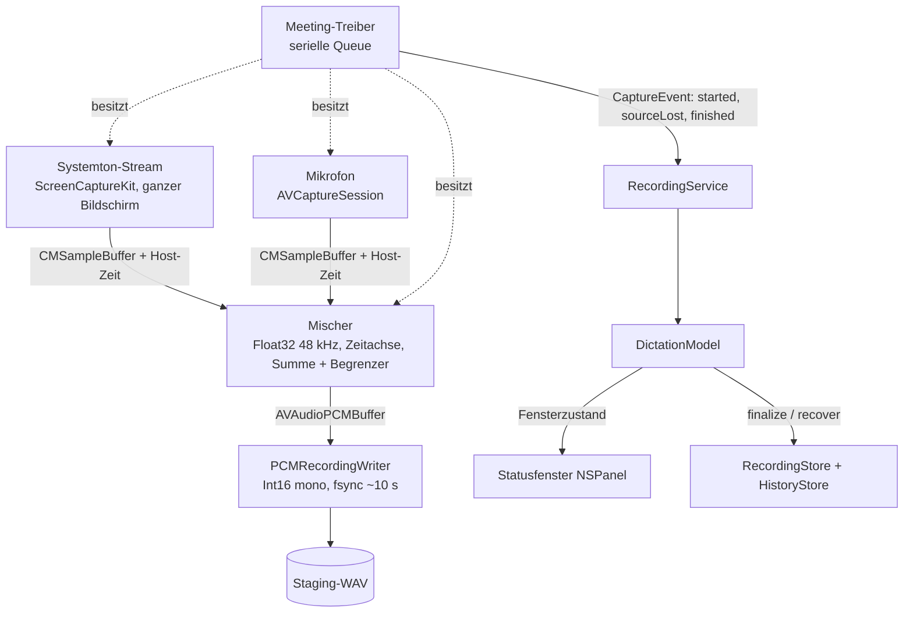
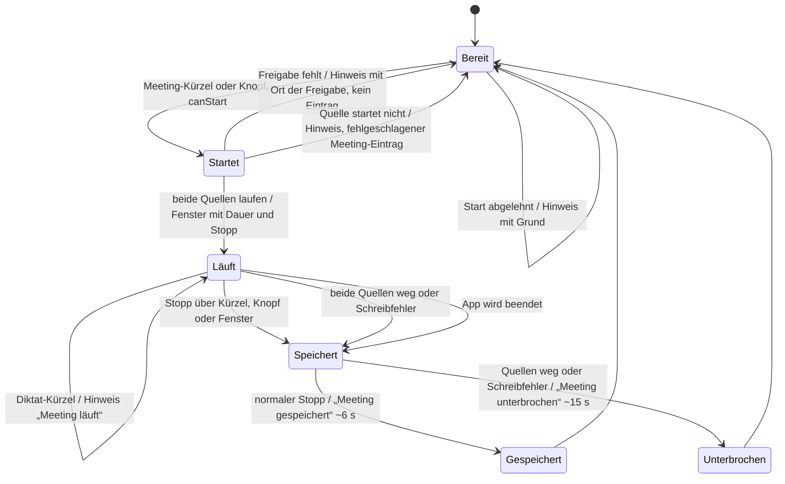

# Meeting-Aufnahme und Statusfenster - Plan

## Goal Capsule

- **Objective:** Meetings aus Teams, Zoom oder dem Browser lassen sich vollständig mitschneiden, damit die Datei danach in Mistral Audio Studio den Sprechern zugeordnet werden kann. Laufende Aufnahmen und Transkriptionen sind jederzeit auf dem Bildschirm sichtbar.
- **Means:** Eine Meeting-Aufnahme aus Systemton und Mikrofon ersetzt die Browser-Aufnahme (KTD1, KTD3). Dazu kommt ein schwebendes Statusfenster (KTD9).
- **Product authority:** `docs/requirements/2026-10-07-prd-draft.md`, ergänzt durch diesen Plan. Bei Konflikten gilt dieser Plan. Er ersetzt die Browser-Hinweis-Regeln (BR3 und „Browser-Hinweis“) und verengt den Meeting-Ablauf der PRD auf „beide Quellen gemischt“. Darunter gilt `AGENTS.md` für Arbeitsweise und Prüfung.
- **Open blockers:** keine.
- **Stop conditions:**
  - Liefert der Praxistest in U8 auf dem echten Mac keinen hörbaren Systemton, stoppt die Arbeit vor U9, und KTD1 wird neu entschieden.
- **Execution profile:** lokal auf dem Mac nach `AGENTS.md`: kein Push, kein Remote, Build und XCTest außerhalb der Agent-Sandbox, echte App-Prüfung durch den Nutzer.
- **Finishes the work:** `ce-work` setzt alle Einheiten außer U7 um und bereitet U7 vor. Die Abnahme in U7 führt der Nutzer auf seinem Mac durch, der Agent dokumentiert sie.

---

## Product Contract

**Product Contract preservation:** changed: R18–R20 ergänzt (Verhalten bei Ausfall einer Quelle, unerwartetes Ende, Dateiname). Der Nutzer hat sie in der Planungs-Zusammenfassung bestätigt. Die früheren Planungsfragen sind durch KTD1, KTD2, KTD3, KTD8 und KTD9 beantwortet. Alle übrigen R- und AE-IDs sind unverändert.

### Summary

Ein eigenes Kürzel oder ein Knopf startet eine Meeting-Aufnahme. Sie nimmt den Systemton aller Apps und dein Mikrofon gemischt in eine WAV auf. Nach dem Stopp liegt die Datei in der History und wird über „Im Finder zeigen“ manuell in Audio Studio hochgeladen. Ein kleines schwebendes Fenster am unteren Bildschirmrand zeigt laufende Aufnahmen und Transkriptionen. Während eines Meetings hat es einen Stopp-Knopf. Technisch wird die vorhandene ScreenCaptureKit-Aufnahme von einem Browser auf alle Apps erweitert und mit dem vorhandenen Mikrofonweg gemischt.

### Problem Frame

Die Browser-Aufnahme aus Slice 2 erfasst nur den Ton eines Browser-Prozesses. Meetings in Teams oder Zoom fehlen ganz, und die eigene Stimme ist nicht in der Datei. Gestartet wird sie nur über einen Hinweis, der bei jeder Browser-Wiedergabe erscheint. Einen sichtbaren Stopp gibt es nicht.

Das Menüleisten-Symbol ist beim Nutzer oft verdeckt. Nach einem Diktat sieht er deshalb nicht, dass noch transkribiert wird. Während einer Aufnahme sieht er auch nicht, ob sie noch läuft.

### Key Decisions

- **Systemton aller Apps plus Mikrofon statt nur eines Browsers.** Meetings laufen auch in nativen Apps. (session-settled: user-directed — chosen over per-browser capture: Teams und Zoom müssen abgedeckt sein und die eigene Stimme gehört in die Datei.) Governs R1, R16.
- **Gemischte Mono-Spur statt Stereo mit getrennten Seiten.** Laut Mistral erkennt Voxtral Sprecher am Inhalt. Getrennte Kanäle werden in der Doku nicht erwähnt, und Stereo würde die Datei verdoppeln. (session-settled: user-directed — chosen over stereo (links Mikrofon, rechts Systemton): der Nutzer wollte Mono, falls Audio Studio daraus Sprecher erkennen kann.) Governs R2.
- **Nach dem Stopp nur speichern.** Die Sprecherzuordnung passiert in Audio Studio, nicht in der App. (session-settled: user-directed — chosen over automatic transcription: Meetings werden bei Bedarf außerhalb der App verarbeitet.) Governs R4.
- **Meeting-Einträge bieten keine In-App-Transkription.** Die App-Transkription liefert keine Sprecher und bricht ab 60 Minuten oder 500 MB ab. (session-settled: user-approved — chosen over in-app transcription with limits: der Upload in Audio Studio ist der eigentliche Weg.) Governs R15.
- **Eigenes Meeting-Kürzel plus Knopf.** Das Diktat-Kürzel bleibt unverändert. (session-settled: user-approved — chosen over sharing the dictation shortcut: Diktat und Meeting sind getrennte Absichten.) Governs R5, R6.
- **Escape stoppt kein Meeting.** Ein Esc in Zoom oder Teams, etwa zum Verlassen des Vollbilds, darf die Aufnahme nicht beenden. Andere Apps brauchen Escape während eines langen Meetings. (session-settled: user-approved — chosen over Escape als zusätzlicher Stopp: versehentliches Beenden ist teurer als ein fehlender Schnellstopp.) Governs R7.
- **Schwebendes Fenster statt nur Menüleisten-Symbol.** Das Symbol ist beim Nutzer oft verdeckt. Governs R12, R13, R14.
- **Browser-Code wird entfernt, nicht nur abgeschaltet.** Er bleibt in der Git-Historie. Das ist eine ausdrücklich freigegebene Ausnahme vom Löschverbot in `AGENTS.md`, die nur für diesen Code gilt. (session-settled: user-approved — chosen over keeping the code disabled: der Nutzer hat „Entfernen“ verlangt.) Governs R16.
- **Kein kleineres Dateiformat.** Eine Stunde ergibt rund 350 MB. Das bleibt so, solange Audio Studio diese Größe annimmt. Governs R2.
- **Ein Ausfall einer Quelle beendet das Meeting nicht.** Ein langes Meeting soll nicht unbemerkt nach zwanzig Minuten enden, nur weil sich das Headset trennt. (session-settled: user-approved — chosen over stopping the whole meeting on any source loss: der Nutzer sieht während des Meetings selten auf die App.) Governs R18, R19.

### Requirements

**Aufnahme**

- R1. Eine Meeting-Aufnahme erfasst gleichzeitig den Systemton aller Apps und das fürs Diktat gewählte Mikrofon.
- R2. Beide Quellen werden zeitgleich in eine Mono-WAV im bestehenden Aufnahmeformat gemischt, sodass beide Seiten hörbar sind.
- R3. Die App begrenzt die Länge einer Meeting-Aufnahme nicht. Sie läuft bis zum Stopp.
- R4. Nach dem Stopp wird die WAV dauerhaft in der History gespeichert, ohne Transkription und ohne Upload.
- R18. Fällt während eines Meetings nur eine Quelle aus, läuft die Aufnahme mit der anderen weiter, und die fehlende Seite bleibt still. Das Fenster warnt bis zum Ende des Meetings, welche Quelle fehlt.
- R19. Erst wenn beide Quellen fehlen oder das Schreiben der Datei scheitert, endet das Meeting von selbst. Das Fenster zeigt dann „Meeting unterbrochen“ mit dem Knopf „Im Finder zeigen“, länger als die normale Meldung nach R13.
- R20. Meeting-Dateien sind am Dateinamen als Meeting erkennbar.

**Starten und Stoppen**

- R5. Ein eigenes globales Meeting-Kürzel, das in den Einstellungen festgelegt wird, startet und stoppt die Meeting-Aufnahme.
- R6. Ein Knopf in der App-Ansicht der Menüleiste startet und stoppt die Meeting-Aufnahme.
- R7. Ein laufendes Meeting stoppen nur das Meeting-Kürzel, der Meeting-Knopf und der Stopp-Knopf im schwebenden Fenster. Escape bleibt während des Meetings für andere Apps frei, und die App-Ansicht zeigt dann keinen Escape-Hinweis.
- R8. Es läuft immer nur eine Aufnahme oder Transkription. Während eines Meetings ignoriert die App das Diktat-Kürzel und zeigt im schwebenden Fenster kurz „Meeting läuft“.
- R9. Während eines Diktats oder einer Transkription starten weder Meeting-Kürzel noch Meeting-Knopf ein Meeting. Das schwebende Fenster zeigt kurz den Grund.
- R10. Fehlt die Freigabe für Systemaudioaufnahme, startet keine Aufnahme. Das schwebende Fenster zeigt kurz, wo die Freigabe erteilt wird.
- R11. Wird die App während eines Meetings beendet, bleibt die bisherige Aufnahme als WAV in der History. Das gilt auch bei Absturz, erzwungenem Beenden oder Stromausfall, dann bis kurz vor dem Ende.

**Schwebendes Fenster**

- R12. Ein kleines Fenster am unteren Bildschirmrand erscheint, solange ein Diktat oder ein Meeting aufgenommen oder eine Aufnahme transkribiert wird. Danach verschwindet es. Die kurzen Hinweise aus R8, R9 und R10 zeigt es ebenfalls; die Warnung aus R18 bleibt bis zum Meeting-Ende, die Meldung aus R19 bleibt länger.
- R13. Das Fenster zeigt, was gerade läuft: Diktat, Meeting oder Transkription. Bei Meetings zeigt es zusätzlich die bisherige Dauer und einen Stopp-Knopf. Nach dem Meeting-Stopp zeigt es einige Sekunden „Meeting gespeichert“ mit Dauer und einem Knopf „Im Finder zeigen“.
- R14. Das Fenster liegt über allen Apps, auch über Meetings im Vollbild und auf allen Spaces. Es nimmt anderen Apps nicht den Fokus.

**History**

- R15. Meeting-Einträge sind in der History als Meeting erkennbar. Sie bieten „Im Finder zeigen“, aber kein Transkribieren, auch nicht im Kontextmenü. Ihr Status ist neutral, etwa „Meeting gespeichert“, auch nach einer unterbrochenen Aufnahme.

**Browser-Aufnahme entfernen**

- R16. Browser-Hinweis, Browser-Erkennung, Browser-Auswahl und deren Einstellung entfallen, der zugehörige Code wird aus dem Projekt entfernt. Die gemeinsame Aufnahmetechnik darf das Meeting weiterverwenden.
- R17. Bereits gespeicherte Browser-Einträge bleiben samt WAV und allen bisherigen Aktionen in der History, auch Transkribieren.

### Acceptance Examples

- AE1. Diktat-Kürzel während eines Meetings
  - **Covers R8.**
  - **Given:** Ein Meeting wird seit zehn Minuten aufgenommen.
  - **When:** Der Nutzer drückt das Diktat-Kürzel.
  - **Then:** Das Meeting läuft weiter, es startet kein Diktat, und das Fenster zeigt kurz „Meeting läuft“.
- AE2. Escape in der Meeting-App
  - **Covers R7.**
  - **Given:** Ein Meeting wird aufgenommen, Zoom ist im Vollbild.
  - **When:** Der Nutzer drückt Esc, um das Vollbild zu verlassen.
  - **Then:** Zoom erhält das Esc, und die Aufnahme läuft weiter.
- AE3. Meeting-Kürzel während eines Diktats
  - **Covers R9.**
  - **Given:** Ein Diktat wird transkribiert.
  - **When:** Der Nutzer drückt das Meeting-Kürzel.
  - **Then:** Es startet keine Meeting-Aufnahme, die Transkription läuft weiter, und das Fenster zeigt kurz, warum kein Meeting startet.
- AE4. Freigabe verweigert
  - **Covers R10.**
  - **Given:** Die Freigabe für Systemaudioaufnahme fehlt.
  - **When:** Der Nutzer startet ein Meeting.
  - **Then:** Es wird nichts aufgenommen, kein History-Eintrag bleibt zurück, und das Fenster nennt den Ort der Freigabe in den Systemeinstellungen.
- AE5. App beenden während eines Meetings
  - **Covers R11.**
  - **Given:** Ein Meeting wird seit 40 Minuten aufgenommen.
  - **When:** Der Nutzer beendet die App.
  - **Then:** Die History enthält eine abspielbare WAV mit den 40 Minuten.
- AE6. Absturz während eines Meetings
  - **Covers R11.**
  - **Given:** Ein Meeting wird seit 40 Minuten aufgenommen.
  - **When:** Die App wird hart beendet, etwa über „Sofort beenden“.
  - **Then:** Nach dem nächsten Start enthält die History eine abspielbare WAV bis kurz vor dem Abbruch.
- AE7. Transkription nach einem Diktat
  - **Covers R12, R13.**
  - **Given:** Der Nutzer beendet ein Diktat.
  - **When:** Die Aufnahme wird zu Mistral geschickt.
  - **Then:** Das Fenster zeigt „Transkription“, bis der Text eingefügt oder gespeichert ist, und verschwindet dann.
- AE8. Alter Browser-Eintrag
  - **Covers R17.**
  - **Given:** Die History enthält eine Browser-Aufnahme aus Slice 2.
  - **When:** Die neue Version startet.
  - **Then:** Der Eintrag und seine WAV sind weiter sichtbar, über „Im Finder zeigen“ erreichbar und transkribierbar.
- AE9. Headset trennt sich mitten im Meeting
  - **Covers R18.**
  - **Given:** Ein Meeting läuft seit 20 Minuten mit dem Bluetooth-Headset als Mikrofon.
  - **When:** Das Headset trennt sich.
  - **Then:** Die Aufnahme läuft mit dem Systemton weiter, die Mikrofonseite bleibt still, und das Fenster warnt „Mikrofon fehlt“ bis zum Stopp.

### Success Criteria

- Ein echtes Meeting von mindestens einer Stunde in Teams oder Zoom, mit Kopfhörern aufgenommen, ergibt eine WAV in der History, in der beide Seiten verständlich sind.
- Audio Studio nimmt diese WAV an und trennt den Nutzer von mindestens einem anderen Sprecher.
- Die Abnahme läuft auch mit dem Bluetooth-Headset (FreeBuds) als Mikrofon.

### Scope Boundaries

- Keine automatische Transkription und kein automatischer Upload von Meetings (per R4).
- Keine Sprechertrennung in der App und keine In-App-Transkription von Meeting-Einträgen (per R15).
- Keine Zeit- oder Größenlimits für Meeting-Aufnahmen (per R3).
- Keine Stereo-Spuren und keine komprimierten Formate.
- Zurückgestellt: Quellenwahl „nur Mikrofon“ oder „nur Systemton“ aus dem Meeting-Ablauf der PRD.
- Zurückgestellt: Meeting-Erkennung oder automatischer Start beim Beitritt.
- Zurückgestellt: Pause und Fortsetzen; die PRD schließt Aufnahme-Pause ohnehin aus.

**Erwogen und nicht gebaut** (jeweils mit dem Befund, der die Entscheidung ändern würde):

- Automatischer Neustart einer ausgefallenen Quelle oder Wechsel auf ein neu verbundenes Headset während eines Meetings. R18 hält die Aufnahme am Leben; das reicht, bis die Abnahme zeigt, dass Ruhezustand oder Displaywechsel den Systemton regelmäßig beenden.
- Markierung der stillen Abschnitte im History-Eintrag. Die Warnung im Fenster genügt, bis der Nutzer Lücken erst beim Upload bemerkt.
- Prüfung des freien Speicherplatzes vor dem Start. Ein Schreibfehler endet nach R19 sichtbar mit gesicherter Teildatei.
- Tolerantes Laden einer beschädigten Kürzel-Einstellung. Die Datei schreibt nur die App selbst, und dasselbe Risiko besteht schon heute für das Diktat-Kürzel.
- Sperren der Mikrofon- und Ordnerwahl während eines Meetings. Die Einstellungen gelten pro Aufnahme ab Start, wie beim Diktat.
- Echo-Unterdrückung für Lautsprecherbetrieb. Die Planung geht von Kopfhörern aus; ändern würde das erst ein realer Bedarf ohne Headset.

### Dependencies / Assumptions

- Der Nutzer trägt im Meeting Kopfhörer. Mit Lautsprechern hört das Mikrofon die anderen mit, und deren Stimmen landen doppelt und leicht versetzt in der Datei.
- Mistral dokumentiert bis zu drei Stunden pro Anfrage, aber keine Größengrenze für Uploads in Audio Studio. Dass rund 350 MB pro Stunde angenommen und Sprecher in einer Mono-Spur getrennt werden, ist ungeprüft. Der Nutzer verzichtet auf einen Vorab-Test und nimmt in Kauf, das Format nachträglich anzupassen; geprüft wird es in der Abnahme (U7). (session-settled: user-directed — chosen over einem einstündigen Upload-Test vor der Umsetzung: keine Zeit für die Testaufnahme, eine spätere Korrektur ist akzeptiert.)
- Ungeprüft ist, ob die Freigabe für Systemaudioaufnahme Neubauten übersteht und ob macOS 15 sie regelmäßig neu abfragt. Die bisherige Quelle belegt den Erhalt nur für Bedienungshilfen und Mikrofon (`docs/solutions/integration-issues/2026-10-09-adhoc-signing-resets-tcc-and-keychain.md`). Die Abnahme prüft es.

### Outstanding Questions

Keine offenen Produktfragen. Die früheren Planungsfragen beantworten KTD1 (Systemton-Technik), KTD3 (Zeitbasis, Pegel, Drift, App-Klänge), KTD2 (Mikrofonwechsel), KTD8 (Kürzel und Konflikte) und KTD9 (Fensterposition). Den Platz des Meeting-Knopfs legt U4 fest.

### Sources / Research

- Heutige Browser-Aufnahme: `DictationBar/UI/BrowserRecordingToast.swift`, `DictationBar/Services/ScreenCaptureBrowserStream.swift`, `DictationBar/Services/BrowserAudioMonitor.swift`. Gestartet wird sie in `DictationBar/State/DictationModel.swift` (`recordSuggestedBrowser`, `executeLive`).
- Escape wird während jeder Aufnahme systemweit belegt (`DictationBar/Services/NativeGlobalShortcutService.swift:76`, `DictationBar/State/DictationModel.swift:138`). Das Diktat-Kürzel stoppt jede laufende Aufnahme (`DictationBar/State/DictationModel.swift:271-278`).
- Das Aufnahmeformat ist 48 kHz, 16 Bit, Mono (`DictationBar/Services/PCMRecordingWriter.swift:11-14`). Die Prüfung beim Laden verlangt Mono (`DictationBar/Services/RecordingStore.swift:36-41`).
- Die In-App-Transkription ist auf 60 Minuten und 500 MB begrenzt (`DictationBar/Services/MistralTranscriptionService.swift:18`).
- „Im Finder zeigen“ gibt es schon (`DictationBar/UI/HistoryView.swift:95-122`). Browser-Einträge erkennt die App an `sourceLabel` (`DictationBar/Models/HistoryEntry.swift:44`).
- Ein Status für „wird transkribiert“ fehlt heute: Das Menüleisten-Symbol wechselt nur bei Aufnahmen (`DictationBar/App/DictationBarApp.swift:32`).
- Meeting-Ablauf und Audio-Suite-Upload stehen in der PRD: `docs/requirements/2026-10-07-prd-draft.md` Zeilen 11-13 und 30-39.
- Mistral, Sprechererkennung und Dauerlimit: [Speech to Text](https://docs.mistral.ai/studio/audio/speech_to_text), [Audio Transcription](https://docs.mistral.ai/capabilities/audio_transcription), [Voxtral Transcribe 2](https://mistral.ai/news/voxtral-transcribe-2).

---

## Planning Contract

### Key Technical Decisions

- KTD1. **Systemton über ScreenCaptureKit mit einem Filter für den ganzen Bildschirm.** Der vorhandene Browser-Stream wird umbenannt und filtert statt einer App den ganzen Bildschirm, ohne die eigene App (`excludesCurrentProcessAudio` bleibt). Damit kommt keine neue Freigabe hinzu, und das Deployment-Ziel macOS 14.0 bleibt. Core Audio Taps sind verworfen: Sie brauchen macOS 14.2, eine eigene Info.plist-Begründung und liefern bei fehlender Freigabe still nur Nullen. Die vorhandene Stream-Schnittstelle bleibt die Naht, an der ein Tap später einziehen kann. Risiko: macOS 15 fragt die Bildschirmaufnahme gelegentlich neu ab (siehe Risks). Governs R1, R10, R16.
- KTD2. **Mikrofon über den vorhandenen AVCaptureSession-Weg, nicht über `captureMicrophone` von ScreenCaptureKit.** Das gibt es erst ab macOS 15, und laut Apple-Forum liefert es keine verlässliche Synchronität mit dem Systemton. Das Meeting nimmt das Mikrofon aus der Diktat-Einstellung zum Startzeitpunkt. Während des Meetings wechselt es nicht automatisch, auch nicht zu einem neu verbundenen Headset. Governs R1, R18.
- KTD3. **Gemischt wird vor dem Schreiber, über Host-Zeit, auf einer seriellen Queue.**
  1. Jede Quelle wird in Float32 mono 48 kHz umgewandelt. Jede hat dafür einen eigenen Konverter, der bei Formatwechseln, etwa Bluetooth mit 16 kHz, neu angelegt wird.
  2. Jeder Puffer wird nach seiner Host-Zeit relativ zum Start einsortiert. Lücken werden zu Stille, Überlappungen werden verworfen. Weicht die Lage um mehr als etwa 20 ms ab, wird neu ausgerichtet. Damit ist auch Uhrendrift abgedeckt.
  3. Ausgegeben wird bis zur Zeit, die beide Quellen erreicht haben. Eine Quelle, die etwa 0,5 s nichts liefert, zählt als still, damit sie die andere nicht aufhält.
  4. Beide Quellen werden mit etwa 0,7 skaliert addiert und am Ende hart auf etwa −1 dBFS begrenzt.
  5. Das Ergebnis geht in die vorhandene Methode `append(AVAudioPCMBuffer)` von `PCMRecordingWriter`. Dessen Konverter sieht dann nur noch ein festes Format.

  Die App-Klänge bleiben über `excludesCurrentProcessAudio` aus dem Systemton. Governs R2, R3.
- KTD4. **Ein Meeting-Treiber besitzt beide Quellen.** Der Start gelingt ganz oder gar nicht: Scheitert eine Quelle innerhalb der vorhandenen 15-Sekunden-Frist, stoppt der Treiber die andere. Weil das Journal dann schon angelegt ist, bleibt wie heute beim Diktat ein Meeting-Eintrag mit Status `.failed` und Fehlermeldung; die History kennt kein Löschen. Nur die fehlende Freigabe wird vor dem Journal geprüft und endet nach AE4 ohne Eintrag. Endet mitten im Meeting nur eine Quelle, meldet der Treiber ein neues Ereignis „Quelle fehlt“ und schreibt weiter. Endet auch die zweite oder scheitert das Schreiben, schließt er wie heute mit „unterbrochen“. Beim Stopp schließt der Treiber den Schreiber nach der ersten bestätigten Quelle oder nach einer zweiten Frist, damit eine hängende Quelle die App nicht dauerhaft blockiert. Governs R18, R19, R11.
- KTD5. **Schutz bei Absturz durch Reparatur beim nächsten Start und regelmäßiges Sichern.** `RecordingStore.recover` repariert vor der Prüfung den 44-Byte-Kopf, den `PCMRecordingWriter` selbst schreibt: Die Größenfelder werden aus der Dateilänge berechnet, auf ganze Frames gekürzt, und die Dauer kommt aus der Größe statt aus einem vollständigen Lesen. Der Schreiber hat keine eigene Queue, er läuft auf der Queue des Treibers. Er synchronisiert deshalb innerhalb seines Schreibaufrufs höchstens etwa alle 10 Sekunden auf die Platte, nach dem Muster von `close()`. Verworfen sind ein laufend nachgeschriebener Kopf (bricht die Treibertests, die einen Kopf mit Größe 0 bis zum Ende erwarten, und hilft nur bei Stromausfall) und Größenfelder mit 0xFFFFFFFF (nicht jedes Programm liest sie). Gilt für alle Aufnahmen, auch Diktate. Governs R11.
- KTD6. **Eintragsart als optionales Feld im History-Eintrag.** `HistoryEntry` bekommt ein optionales Feld für die Art. Fehlt es, handelt es sich um ein Diktat oder einen alten Eintrag. Das Feld wird schon bei `prepare` ins Journal geschrieben, damit ein Absturz ein Meeting nicht in ein Diktat verwandelt. Die Schema-Version bleibt 1, alte Journale lesen das Feld als leer. Meeting-Dateien beginnen mit `Meeting-`; `HistoryStore.validate` akzeptiert beide Präfixe. Auch das Modell verweigert die erneute Transkription eines Meetings, nicht nur die Oberfläche. Browser-Einträge behalten `sourceLabel` und ihr Verhalten. Governs R15, R17, R20.
- KTD7. **Eigener Meeting-Ablauf im Modell.**
  - `OperationOrigin.browserRecording` heißt künftig `.meeting`; der Wert wird nirgends gespeichert.
  - `toggleMeeting` startet nur bei `canStart` und stoppt nur ein laufendes Meeting. `toggleRecording` ignoriert während eines Meetings den Aufruf und meldet „Meeting läuft“.
  - Der Meeting-Weg ruft `setCaptureActive(true)` nicht auf, Escape wird also nicht registriert.
  - Ein Stopp während `.preparing` wird ignoriert.
  - Gleichzeitige Stoppgründe haben eine feste Rangfolge: Beenden vor normalem Stopp vor Unterbrechung, sodass ein Stopp des Nutzers nicht als Unterbrechung gilt.
  - Abgelehnte Starts melden ihren Grund: läuft schon, Beenden läuft, ungesicherte Aufnahme ausstehend, Aufnahme noch aktiv, Ordner fehlt, Mikrofon verweigert.

  Governs R5–R9, R7.
- KTD8. **Meeting-Kürzel als zweiter Carbon-Hotkey.** Neu ist `AppConfiguration.meetingShortcut`, optional mit der Voreinstellung ⌃⌥M. Der Router bekommt die Hotkey-ID 3 und einen eigenen Callback. Diktat- und Meeting-Kürzel werden getrennt registriert, damit ein Fehler beim einen das andere nicht blockiert. Das Modell lehnt ein Meeting-Kürzel ab, das dem Diktat-Kürzel gleicht, und nennt den Grund. Scheitert die Registrierung, etwa weil eine andere App das Kürzel belegt, steht der Hinweis in den Einstellungen, und der Knopf funktioniert weiter. `ShortcutRecorder` bekommt einen Titel-Parameter. Governs R5.
- KTD9. **Eigener Fensterzustand im Modell, das Fenster selbst gehört dem AppDelegate.**
  - Das Modell stellt den Zustand des Fensters bereit: die laufende Tätigkeit sowie eine Meldung mit ID, Art, Text, optionalem Eintrag und Dauer. Er wird nicht aus `phase` abgeleitet, weil `finish(error:)` `.failed` stehen lässt.
  - Eine neue Tätigkeit verdrängt jede Meldung. Ein alter Timer kann eine neuere Meldung nicht ausblenden.
  - Meldungsdauern: „Meeting gespeichert“ etwa 6 s, „Meeting unterbrochen“ etwa 15 s mit Ton, Fehler aus `finish(error:)` etwa 8 s, „Freigabe fehlt“ mit Ort der Freigabe und einem Knopf „Systemeinstellungen öffnen“, der direkt den Bereich für Bildschirm- und Systemaudioaufnahme öffnet, etwa 10 s, übrige kurze Hinweise etwa 3 s.
  - Die Quellenwarnung nach R18 hat einen eigenen Platz neben der Meldung. Keine Meldung und kein Timer überschreibt sie; sie gilt bis zum Meeting-Ende. Beim Eintreffen spielt einmal derselbe Ton wie bei „Meeting unterbrochen“, und sie ist mit Warnfarbe und Symbol von der normalen Anzeige abgesetzt.
  - Während `.preparing` eines Meetings zeigt das Fenster „Meeting startet …“, während des Speicherns „Meeting wird gespeichert …“, beide ohne Stopp-Knopf und ohne Dauer.
  - Die Meetingdauer zählt ab dem Übergang zu `.recording`.
  - Das `NSPanel` ist randlos und nicht aktivierend, kann nicht Key-Fenster werden und reagiert auf den ersten Klick. Level `.screenSaver` (laut Apple-Entwicklersupport nötig über fremdem Vollbild), Verhalten `canJoinAllSpaces`, `fullScreenAuxiliary`, `stationary`.
  - Position: unten rechts auf dem Bildschirm, auf dem beim Einblenden die Maus ist. So bleibt die Steuerleiste von Zoom und Teams in der Mitte frei. Das Fenster lässt sich mit der Maus verschieben, ohne den Fokus zu nehmen; die zuletzt gewählte Position gilt für die nächsten Einblendungen. Liegt sie auf keinem angeschlossenen Bildschirm mehr, kehrt das Fenster nach unten rechts zurück. (session-settled: user-approved — chosen over fester Position: ein Fenster über Chat oder Seitenleiste soll sich wegschieben lassen.)
  - Erzeugt wird das Fenster im AppDelegate, weil ein `if` im SceneBuilder den Compiler abstürzen lässt (`docs/solutions/build-errors/2026-10-09-scenebuilder-if-compiler-crash.md`).
  - Erscheint das Fenster in der Abnahme nicht über Zoom oder Teams im Vollbild, wird DictationBar zur reinen Menüleisten-App (`LSUIElement` = true). (session-settled: user-approved — chosen over sofortigem Wegfall des Dock-Symbols: erst testen, nur bei Bedarf umstellen.)

  Governs R12–R14, R8–R10, R18, R19.
- KTD10. **Umfang des Entfernens.**
  - Gelöscht werden `BrowserAudioTarget.swift`, `BrowserAudioMonitor.swift` und `BrowserRecordingToast.swift`.
  - Umbenannt und angepasst werden `ScreenCaptureBrowserStream.swift` (Systemton-Stream) und `NativeBrowserCaptureDriver.swift` (Meeting-Treiber). Die Git-Historie bleibt so lesbar.
  - Vorher wandert die Freigabeabfrage `CGPreflightScreenCaptureAccess() || CGRequestScreenCaptureAccess()` aus dem Monitor in eine optionale Closure an `DictationServices`. `DictationRuntime` setzt sie, fehlt sie, gilt die Freigabe als verweigert, und Tests setzen sie selbst. Der Fehlertyp `BrowserCaptureAccessFailure` wird umbenannt und für R10 weiterverwendet.
  - `browserSuggestions` fällt aus der Konfiguration; alte Dateien laden weiter, weil der Decoder unbekannte Schlüssel ignoriert.
  - Testdateien werden nicht gelöscht, sondern umbenannt: `NativeBrowserCaptureDriverTests.swift` → `NativeMeetingCaptureDriverTests.swift` (U8) und `BrowserBluetoothTests.swift` → `BluetoothMicrophoneTests.swift` (U9). In ihnen entfallen nur die reinen Browser-Testfälle; die beiden Bluetooth-Tests bleiben erhalten.

  Governs R16, R17.

### High-Level Technical Design

Datenfluss einer Meeting-Aufnahme:



Ablauf eines Meetings im Modell und im Fenster:



Platzierung im Mischer (Skizze der Richtung, keine Implementierungsvorgabe):

```text
für jeden Puffer einer Quelle:
  soll = runde((hostZeit - startZeit) * 48000)
  ist  = bisher geschriebene Frames dieser Quelle
  wenn soll - ist > 20 ms:  Stille bis soll anfügen
  wenn ist - soll > 20 ms:  vordere Frames verwerfen
  Frames an den Ring der Quelle anhängen
ausgeben bis min(Stand A, Stand B), wobei eine Quelle ohne Daten seit 0,5 s als still bis jetzt zählt
mix = begrenze((a + b) * 0,7, -1 dBFS)
```

### Implementation Constraints

- Arbeitsweise, Build, XCTest und App-Prüfung nur lokal nach `AGENTS.md`. Kein Push, kein Remote.
- `DictationBar.xcodeproj/project.pbxproj` führt jede Datei einzeln. Jedes Anlegen, Umbenennen und Löschen braucht dort einen passenden Eintrag.
- Signatur-Identität „DictationBar Local Signing“ und Bundle-ID `com.primocammino.DictationBar` bleiben unverändert, sonst verfallen die Freigaben. Keine globalen TCC-Resets.
- Deployment-Ziel macOS 14.0 und Swift 5 bleiben. App-Sandbox bleibt aus.
- Löschen ist nur für die in KTD10 genannten Browser-Dateien und für Browser-Code und Browser-Testfälle innerhalb der dort genannten umbenannten Dateien freigegeben.
- Alle sichtbaren Texte bleiben deutsch, Fehler bleiben `LocalizedError`-Enums.

### Sequencing

Jede Einheit endet mit grünem Build und grünen Tests und lässt sich als ein Commit landen. Reihenfolge: U1, U2, U3, U8, U9, U4, U5, U6, U7.

1. Kein Vorab-Test in Audio Studio; Größe und Sprechertrennung prüft U7 (siehe Dependencies / Assumptions).
2. U1, U2 und U3 sind voneinander unabhängig.
3. U8 braucht U3 und endet mit dem Praxistest auf dem echten Mac. Erst danach folgt U9.
4. U9 braucht U8. U4 braucht U2 und U9. U5 und U6 brauchen U4.
5. U7 braucht alles.

### Risks & Dependencies

| Risiko | Wirkung | Umgang |
|---|---|---|
| Der ScreenCaptureKit-Weg wurde nie auf echter Hardware abgenommen (`docs/validation/slice-2-review-fixes-2026-10-09.md`) | Meeting ohne Systemton | Praxistest am Ende von U8 vor allem Weiteren, Stop-Bedingung in der Goal Capsule |
| macOS 15 fragt die Bildschirmaufnahme gelegentlich neu ab | Abfrage beim Meeting-Start oder abgebrochener Stream | Start scheitert nach R10 sichtbar; ein Abbruch mitten im Meeting fällt unter R18; Prüfung in U7 |
| Systemton bei stummgeschalteter oder leiser Ausgabe | Andere Seite fehlt in der Datei | Prüfung in U7 |
| Bluetooth-Headset wechselt auf 16 kHz und schlechtere Ausgabe | Formatwechsel mitten im Meeting | Neuer Konverter pro Quelle (KTD3), Prüfung mit den FreeBuds in U7 |
| Fenster erscheint nicht über fremdem Vollbild, weil die App ein Dock-Symbol hat | R14 verfehlt | Rückfall auf reine Menüleisten-App (KTD9) |
| Drift oder Klicks durch Neuausrichtung | Hörbare Sprünge | Toleranz 20 ms, Prüfung mit einstündiger Aufnahme in U7 |
| Freigabe übersteht Neubauten nicht | Nachfrage nach jedem Build | Signatur unverändert lassen, Prüfung in U7 |

### System-Wide Impact

- Die Reparatur beim Start (KTD5) und das `fsync` gelten auch für Diktate. Ein abgestürztes Diktat ist künftig ebenfalls wiederherstellbar.
- `toggleRecording`, die Escape-Registrierung und die Fehlermeldungen des Modells ändern sich für alle Abläufe. Die bestehenden Diktat-Tests müssen unverändert grün bleiben.
- Gesamtzahl der Tests: Browser-Tests fallen weg, Meeting-Tests kommen hinzu. U7 hält die neue Zahl fest; die letzte Basis waren 108 Tests.

### Deferred to Implementation

- Genaue Namen von Typen, Methoden und Ereignissen.
- Ob der Mikrofonteil von `NativeCaptureDriver` herausgelöst oder über eine einspeisbare Senke wiederverwendet wird; beides erfüllt KTD2. Für das Meeting muss ein Mikrofonverlust zum Ereignis „Quelle fehlt“ werden statt zum Ende der Aufnahme (heute `interruptOnQueue` in `NativeRecordingService.swift`).
- Genaue Toleranzen im Mischer (20 ms, 0,5 s, Faktor 0,7), sobald echte Aufnahmen vorliegen.
- Welche Uhr die Zeitstempel tragen: Mikrofonpuffer laufen auf der `synchronizationClock` der Capture-Session, die bei reiner Audio-Aufnahme eine Geräteuhr sein kann. Vor dem Mischer beide Quellen auf die Host-Uhr umrechnen (etwa mit `CMSyncConvertTime`), sonst misst KTD3 gegen die falsche Zeitbasis.
- Ob Level `.screenSaver` Mission Control stört; dann `.statusBar` mit denselben Verhaltensflags erneut prüfen.

---

## Implementation Units

### U1. Aufnahmen überstehen Absturz und Stromausfall

- **Goal:** Eine Aufnahme, deren App hart endet, ist nach dem nächsten Start abspielbar in der History.
- **Requirements:** R11, AE6 (KTD5).
- **Dependencies:** keine.
- **Files:**
  - `DictationBar/Services/PCMRecordingWriter.swift`
  - `DictationBar/Services/RecordingStore.swift`
  - `DictationBarTests/RecordingStoreTests.swift`
  - `DictationBarTests/PCMRecordingWriterTests.swift`
- **Approach:**
  1. Den Kopf-Bau des Schreibers (heute privat und statisch) für die Reparatur zugänglich machen, ohne die Schreiblogik zu verändern.
  2. In `recover` vor `inspect` den Kopf aus der Dateilänge reparieren: Größen neu setzen und auf ganze Frames kürzen, ohne die Datei vollständig zu lesen.
  3. Im Schreiber innerhalb des Schreibaufrufs höchstens etwa alle 10 Sekunden auf die Platte synchronisieren (KTD5), ohne den Kopf zu ändern.
- **Patterns to follow:** Kürzen und Kopf in `PCMRecordingWriter.close()`; Ablauf von `RecordingStore.recover`.
- **Test scenarios:**
  - Covers AE6. Eine Staging-Datei mit Kopf-Größe 0 und 3 s Audiodaten wird bei `recover` zu einem Eintrag mit etwa 3 s Dauer, nicht zu `.failed`.
  - Eine Staging-Datei mit ungerader Byte-Zahl hinter dem Kopf wird auf ganze Frames gekürzt und besteht die Prüfung.
  - Eine Staging-Datei ohne Audiodaten hinter dem Kopf bleibt `.failed` mit der bisherigen Meldung.
  - Ein ordentlich geschlossener Eintrag wird bei `recover` nicht erneut verändert.
  - Der Schreiber erzeugt bei normalem Ablauf weiter dieselbe Datei wie bisher (bestehende Writer-Tests grün).
- **Verification:** Die neuen Recovery-Tests laufen grün. Die bestehenden Tests, die einen Kopf mit Größe 0 bis zum Schließen erwarten, bleiben unverändert grün.

### U2. Meeting-Einträge in der History

- **Goal:** Meeting-Einträge sind als Meeting erkennbar, neutral beschriftet und nicht transkribierbar. Alte Einträge verhalten sich wie bisher.
- **Requirements:** R15, R17, R20, AE8 (KTD6).
- **Dependencies:** keine.
- **Files:**
  - `DictationBar/Models/HistoryEntry.swift`
  - `DictationBar/Services/HistoryStore.swift`
  - `DictationBar/UI/HistoryView.swift`
  - `DictationBar/State/DictationModel.swift` (nur Retry-Sperre)
  - `DictationBarTests/HistoryStoreTests.swift`
  - `DictationBarTests/DictationPipelineTests.swift`
- **Approach:**
  1. Optionales Feld für die Art am Eintrag. Die Initialisierung mit Art „Meeting“ erzeugt Dateinamen mit `Meeting-`, und `validate` akzeptiert diese Namen.
  2. In der History-Zeile einen Meeting-Zweig vor die Status-Fälle setzen. Neutral „Meeting gespeichert“ bei `.pending`, `.interrupted` und `.complete`; bei `.failed` bleibt die Fehlermeldung. Eigenes Symbol, kein Transkribieren im Knopf und im Kontextmenü. Die gespeicherte `message` (etwa „Transkription bitte bewusst starten“ aus `RecordingStore`) blendet die Zeile für Meetings aus, außer bei `.failed`.
  3. `revealInFinder` aus `HistoryRow` als nicht private Erweiterung von `HistoryEntry` auf Dateiebene herauslösen, damit das Statusfenster sie in U6 nutzen kann.
  4. `retry` lehnt Meeting-Einträge ab.
  5. Den Leertext der History neutral fassen, damit er Meetings nicht ausschließt.
- **Patterns to follow:** Der `sourceLabel`-Zweig in `HistoryView` für Browser-Einträge; das abwärtskompatible Codable-Muster der vorhandenen optionalen Felder.
- **Test scenarios:**
  - Ein Journal ohne das neue Feld lädt unverändert; der Eintrag gilt als Diktat.
  - Covers AE8. Ein alter Browser-Eintrag mit `sourceLabel` lädt und bleibt über `retry` transkribierbar.
  - Ein Meeting-Eintrag erhält einen Dateinamen mit `Meeting-` und besteht `validate`.
  - Ein manipulierter Meeting-Eintrag mit falschem Präfix wird von `validate` abgelehnt wie bisher.
  - `retry` auf einen Meeting-Eintrag ohne Transkript tut nichts und startet keine Operation.
  - Ein unterbrochener Meeting-Eintrag mit der Meldung „Transkription bitte bewusst starten“ wird neutral als „Meeting gespeichert“ beschriftet, ohne diese Meldung.
- **Verification:** Die History-Tests sind grün. In der laufenden App zeigt ein Meeting-Eintrag keinen Transkribieren-Knopf und keinen Kontextmenü-Eintrag dafür (Prüfung in U7).

### U3. Mischer für zwei Quellen

- **Goal:** Ein eigenständiger Mischer bringt zwei Quellen mit eigenen Uhren auf eine gemeinsame Zeitachse und liefert eine begrenzte Mono-Summe.
- **Requirements:** R2, R3 (KTD3).
- **Dependencies:** keine.
- **Files:**
  - `DictationBar/Services/MeetingMixer.swift` (neu)
  - `DictationBar.xcodeproj/project.pbxproj`
  - `DictationBarTests/MeetingMixerTests.swift` (neu)
- **Approach:** Mischer nach KTD3 als eigenen, synchron testbaren Typ bauen. Er nimmt Puffer mit Host-Zeit je Quelle an und gibt fertige Puffer im Schreiberformat aus. Außer den Konvertern hält er keinen AVFoundation-Zustand. Die Einheit ist rein additiv, nichts ruft den Mischer schon auf.
- **Patterns to follow:** Formatumwandlung mit `AVAudioConverter` und Konverter-Neuanlage bei Formatwechsel in `PCMRecordingWriter.append`.
- **Test scenarios:**
  - Zwei Quellen mit Sinus auf verschiedenen Frequenzen und gleicher Host-Zeit ergeben eine Ausgabe, in der beide Frequenzen enthalten sind.
  - Eine Lücke von 200 ms in einer Quelle wird zu 200 ms Stille dieser Quelle, die andere läuft ungestört.
  - Eine Quelle mit 16 kHz und eine mit 48 kHz ergeben 48 kHz ohne Längenabweichung über 1 %.
  - Liefert eine Quelle länger als 0,5 s nichts, gibt der Mischer die andere trotzdem aus.
  - Zwei Vollaussteuerungen addiert überschreiten −1 dBFS nicht.
  - Eine Drift von 100 ppm über simulierte 10 Minuten bleibt innerhalb der 20-ms-Toleranz ausgerichtet.
  - Ein Puffer mit Host-Zeit vor dem Start wird verworfen.
- **Verification:** Die Mischer-Tests sind grün, der Build ist unverändert grün.

### U8. Systemton-Stream und Meeting-Treiber

- **Goal:** Ein Treiber nimmt Systemton aller Apps und Mikrofon gleichzeitig auf, mischt beide über U3 und schreibt eine Mono-WAV. Ein echter Praxistest auf dem Mac belegt das.
- **Requirements:** R1, R2, R18, R19 (KTD1, KTD2, KTD4).
- **Dependencies:** U3.
- **Files:**
  - `DictationBar/Services/ScreenCaptureBrowserStream.swift` → `DictationBar/Services/SystemAudioStream.swift`
  - `DictationBar/Services/NativeBrowserCaptureDriver.swift` → `DictationBar/Services/NativeMeetingCaptureDriver.swift`
  - `DictationBar/Services/NativeRecordingService.swift` (Mikrofonteil wiederverwendbar machen)
  - `DictationBar/Services/RecordingService.swift` (Meeting-Start statt Browser-Start, Ereignis „Quelle fehlt“)
  - `DictationBar/App/DictationRuntime.swift` (Verdrahtung der Meeting-Fabrik)
  - `DictationBar/State/DictationModel.swift` (nur vorläufige Brücke im Browser-Zweig von `executeLive`)
  - `DictationBar/UI/StatusView.swift` (nur vorläufiger Startknopf für den Praxistest)
  - `DictationBar.xcodeproj/project.pbxproj`
  - `DictationBarTests/NativeBrowserCaptureDriverTests.swift` → `DictationBarTests/NativeMeetingCaptureDriverTests.swift`
  - `DictationBarTests/RecordingServiceTests.swift`
  - `DictationBarTests/PipelineFixture.swift` (Fake für den Meeting-Start)
- **Approach:**
  1. Stream auf einen Filter für den ganzen Hauptbildschirm ohne die eigene App umstellen. Die Konfiguration bleibt sonst gleich, die Browser-Zielangabe entfällt aus der Signatur.
  2. Treiber nach KTD4: beide Quellen und der Mischer auf einer seriellen Queue, Start ganz oder gar nicht, Ereignis „Quelle fehlt“ statt Ende bei einer einzelnen Quelle, Ende bei zwei fehlenden Quellen oder Schreibfehler, getrennte Stopp-Fristen. Der heutige Mikrofonverlust über `interruptOnQueue` wird im Meeting zum Ereignis „Quelle fehlt“.
  3. `RecordingService` ersetzt `startBrowser` und die Browser-Fabrik durch einen Meeting-Start mit Mikrofon-ID und Pfaden. Der neue Rückruf für „Quelle fehlt“ bekommt eine Standard-Implementierung, damit bestehende Fakes unverändert kompilieren.
  4. Vorläufige Brücke: Der Browser-Zweig in `executeLive` ruft den Meeting-Start mit dem Mikrofon der Sitzung auf. Ein vorläufiger Knopf in `StatusView` startet diesen Zweig direkt, ohne Browser-Erkennung, die auf echter Hardware nie abgenommen wurde. U9 entfernt Brücke und Knopf wieder.
- **Execution note:** Am Ende der Einheit zwei echte Aufnahmen auf dem Mac, jeweils über den vorläufigen Knopf gestartet. Erstens ein Video in beliebiger App, dazu sprechen. Zweitens ein Testanruf in Teams oder Zoom mit Kopfhörern, wobei die Meeting-App dasselbe Mikrofon nutzt wie die Diktat-Einstellung. Beide WAVs abspielen, bevor U9 beginnt. Fehlt der Ton der Meeting-App oder die eigene Stimme, greift die Stop-Bedingung.
- **Patterns to follow:**
  - Queue-Bindung, Stopp-Bestätigung und Generationsschutz in `NativeBrowserCaptureDriver`.
  - Harness, kontrollierter Stream und synthetische `CMSampleBuffer` in `NativeBrowserCaptureDriverTests`. Lehre aus Slice 2: Die Tests treiben den echten Treiber.
  - Die Standard-Implementierung per Protokoll-Erweiterung in `RecordingService.swift` und die Callback-Verdrahtung im Modell (`DictationModel.swift`, Abschnitt mit `onInterruption` und `onEscape`).
- **Test scenarios:**
  - Beide Quellen starten → Ereignis „gestartet“; die WAV enthält gemischte Frames.
  - Die Mikrofonquelle startet nicht innerhalb der Frist → der Systemton wird gestoppt, Ereignis „Start fehlgeschlagen“, keine offene Datei.
  - Covers AE9. Die Mikrofonquelle endet mitten in der Aufnahme → Ereignis „Quelle fehlt (Mikrofon)“, die Aufnahme schreibt weiter Systemton.
  - Der Systemton-Stream endet mit Fehler → Ereignis „Quelle fehlt (Systemton)“, das Mikrofon schreibt weiter.
  - Beide Quellen enden → Ereignis „beendet, unterbrochen“, der Schreiber ist geschlossen.
  - Eine Quelle bestätigt den Stopp nicht → der Schreiber schließt nach der zweiten Frist, `isActive` wird frei.
  - Späte Rückrufe nach dem Ende verändern nichts (bestehender Schutz bleibt).
  - `RecordingService` leitet „Quelle fehlt“ an den Rückruf weiter und meldet keine Unterbrechung.
- **Verification:** Build und alle Tests grün. Der Praxistest ergibt eine hörbare WAV mit beiden Seiten; das Ergebnis steht im Validierungsbericht von U7.

### U9. Browser-Weg entfernen

- **Goal:** Kein Browser-Hinweis, keine Browser-Erkennung und keine Browser-Einstellung mehr; alte Browser-Einträge bleiben nutzbar.
- **Requirements:** R16, R17, AE8 (KTD10).
- **Dependencies:** U8 mit erfolgreichem Praxistest.
- **Files:**
  - gelöscht: `DictationBar/Models/BrowserAudioTarget.swift`, `DictationBar/Services/BrowserAudioMonitor.swift`, `DictationBar/UI/BrowserRecordingToast.swift`
  - `DictationBar/App/DictationRuntime.swift` (Freigabe-Closure statt `browserAudio`)
  - `DictationBar/App/AppDelegate.swift` (Hinweis-Verdrahtung)
  - `DictationBar/State/DictationModel.swift` (Browser-Felder, Hinweis-Politik, `recordSuggestedBrowser`, Brücke aus U8)
  - `DictationBar/Models/AppConfiguration.swift` (`browserSuggestions`)
  - `DictationBar/UI/SettingsView.swift` (Abschnitt „Browser-Audio“)
  - `DictationBar/UI/StatusView.swift` (Beschriftung „Browseraufnahme“, vorläufiger Startknopf aus U8)
  - `DictationBar/Services/Permissions.swift` (Kommentar)
  - `DictationBar.xcodeproj/project.pbxproj`
  - `README.md`
  - `DictationBarTests/PipelineFixture.swift` (`PipelineBrowserMonitor` durch die Freigabe-Closure ersetzen)
  - `DictationBarTests/BrowserBluetoothTests.swift` → `DictationBarTests/BluetoothMicrophoneTests.swift`
- **Approach:**
  1. Freigabe-Closure an `DictationServices` nach KTD10 einführen und in `DictationRuntime` setzen, bevor der Monitor fällt.
  2. Die drei Browser-Dateien und ihre Projekteinträge löschen; diese Löschung ist durch die Key Decision zum Browser-Code freigegeben.
  3. Browser-Felder, Hinweis-Politik, `recordSuggestedBrowser`, die Brücke und den vorläufigen Knopf aus U8 entfernen. Den Browser-Zweig in `executeLive` lässt U4 als Meeting-Zweig neu entstehen; bis dahin bleibt der Meeting-Start ohne Auslöser.
  4. `browserSuggestions` und den Einstellungsabschnitt entfernen.
  5. Die beiden Bluetooth-Tests in die umbenannte Datei übernehmen. Die Browser-Tests entfallen mit dem Browser-Weg; U4 baut die Tests für verweigerte Freigabe ohne Journal und für Speichern ohne Transkription aus ihnen als Meeting-Tests nach (Git-Historie).
  6. README: Browser-Text entfernen.
- **Patterns to follow:** bestehende optionale Dienste in `DictationServices` mit Testprofil ohne native Adapter (`RuntimeInitializationTests`).
- **Test scenarios:**
  - Eine alte Konfigurationsdatei mit `browserSuggestions` lädt ohne Fehler.
  - Covers AE8. Ein alter Browser-Eintrag mit `sourceLabel` bleibt sichtbar und transkribierbar (bestehender Test aus U2 bleibt grün).
  - Die beiden Bluetooth-Tests laufen unverändert in der umbenannten Datei.
  - Das Testprofil baut ohne native Adapter und ohne Freigabe-Closure (bestehender Initialisierungstest).
- **Verification:** Build und alle Tests grün; im Projekt gibt es keine Treffer mehr für `BrowserAudioTarget`, `browserSuggestions`, `BrowserRecordingToast` und `recordSuggestedBrowser`.

### U4. Meeting-Ablauf im Modell und in der App-Ansicht

- **Goal:** Das Modell startet und stoppt Meetings über einen eigenen Weg, sperrt Diktate währenddessen und belegt kein Escape. Die App-Ansicht hat einen Meeting-Knopf.
- **Requirements:** R4, R6, R7, R8, R9, R10, R11, AE1, AE2, AE3, AE4, AE5 (KTD6, KTD7).
- **Dependencies:** U2, U9.
- **Files:**
  - `DictationBar/State/DictationModel.swift`
  - `DictationBar/Models/DictationSession.swift`
  - `DictationBar/UI/StatusView.swift`
  - `DictationBarTests/PipelineFixture.swift`
  - `DictationBarTests/MeetingPipelineTests.swift` (neu)
  - `DictationBarTests/TerminationTests.swift`
  - `DictationBarTests/DictationPipelineTests.swift`
- **Approach:**
  1. `.browserRecording` wird zu `.meeting`. Der Meeting-Start folgt dem Muster `guard canStart` → `begin(.meeting)` → `executeLive`.
  2. Im Meeting-Zweig von `executeLive`: Mikrofon- und Systemaudio-Freigabe vor dem Journal, Art „Meeting“ beim `prepare`, kein `setCaptureActive(true)`, kein Mikrofonwechsel, Meeting-Start im Recorder.
  3. `toggleMeeting` und `toggleRecording` nach KTD7, Stoppgrund-Rangfolge, Stopp während `.preparing` ignorieren, abgelehnte Starts mit Grund.
  4. Das Ereignis „Quelle fehlt“ aus U8 im Modell entgegennehmen und für U6 als Warnung festhalten.
  5. Abschlussmeldungen für Meetings neutral: „Meeting gespeichert“ statt „WAV gespeichert. Transkription ist über die History möglich.“
  6. StatusView: eigener Meeting-Knopf mit dem Titel „Meeting starten“ oder „Meeting stoppen“. Während eines Meetings kein Escape-Hinweis, Statuszeile „Meeting“, und der Diktat-Knopf ist gesperrt. Während eines Diktats oder einer Transkription ist der Meeting-Knopf gesperrt.
  7. README: Escape-Aussage und Meeting-Bedienung ergänzen.
- **Patterns to follow:** das frühere `recordSuggestedBrowser` als Startvorlage (Git-Historie); `PipelineFixture` mit `PipelineRecorder` und `PipelineShortcuts` (zeichnet `escapeActive` auf); die Browser-Tests aus `BrowserBluetoothTests.swift` (Git-Historie) als Vorlage für AE4 und das Speichern ohne Transkription.
- **Test scenarios:**
  - Ein Meeting-Start ohne laufende Operation erzeugt einen Eintrag mit Art „Meeting“ und Präfix `Meeting-`.
  - Covers AE2. Während eines Meetings ist Escape nicht registriert (`escapeActive` bleibt false).
  - Covers AE1. Diktat-Toggle während eines Meetings: Das Meeting läuft weiter, es gibt keinen neuen Eintrag, und die Meldung „Meeting läuft“ ist gesetzt.
  - Covers AE3. Meeting-Toggle während einer Transkription: kein Start, Meldung mit Grund.
  - Covers AE4. Die Systemaudio-Freigabe wird verweigert: kein Journal-Eintrag, Meldung mit dem Ort der Freigabe.
  - Meeting-Stopp führt zu einem gespeicherten Eintrag ohne Aufruf von Transkription oder Einfügen.
  - Covers AE5. Beenden während eines Meetings sichert die WAV, und der Eintrag erscheint neutral.
  - Stopp des Nutzers und gleichzeitige Unterbrechung ergeben einen normalen Stopp.
  - Meeting-Toggle während `.preparing` ändert nichts.
  - Das Ereignis „Quelle fehlt“ beendet das Meeting nicht und setzt die Warnung.
  - Die bestehenden Diktat- und Escape-Tests bleiben grün.
- **Verification:** Build und alle Tests grün; die App-Ansicht zeigt den Meeting-Knopf und keinen Escape-Hinweis während eines Meetings (Prüfung in U7).

### U5. Meeting-Kürzel

- **Goal:** Ein eigenes globales Kürzel startet und stoppt Meetings und lässt sich in den Einstellungen ändern.
- **Requirements:** R5 (KTD8).
- **Dependencies:** U4.
- **Files:**
  - `DictationBar/Services/GlobalShortcutService.swift`
  - `DictationBar/Services/NativeGlobalShortcutService.swift`
  - `DictationBar/Models/AppConfiguration.swift`
  - `DictationBar/Models/DictationShortcut.swift`
  - `DictationBar/UI/ShortcutRecorder.swift`
  - `DictationBar/UI/SettingsView.swift`
  - `DictationBar/State/DictationModel.swift`
  - `DictationBarTests/GlobalShortcutTests.swift`
  - `DictationBarTests/DictationShortcutTests.swift`
  - `DictationBarTests/ModelRecoveryTests.swift`
  - `DictationBarTests/PipelineFixture.swift`
- **Approach:**
  1. Router um Hotkey-ID 3 und einen Meeting-Callback erweitern, mit Wiederholungsschutz wie bei ID 1.
  2. Nativer Dienst: Meeting-Kürzel getrennt konfigurieren und registrieren, mit derselben Tauschreihenfolge: das neue registrieren, bevor das alte entfernt wird. Den Carbon-Event-Handler einmal und unabhängig von einem Hotkey installieren. Die Hotkeys 1 und 3 einzeln registrieren und entfernen; scheitert einer, wird nur dieser freigegeben. Heute entfernt ein Fehler bei Hotkey 1 über `unregister()` alles, und `register()` kehrt bei vorhandenem Handler früh zurück. `register()` muss Hotkey 1 nachregistrieren, wenn er fehlt.
  3. Modell: Meeting-Kürzel laden, Voreinstellung ⌃⌥M, Gleichheit mit dem Diktat-Kürzel ablehnen, Registrierungsfehler getrennt melden.
  4. Einstellungen: zweiter `ShortcutRecorder` mit eigenem Titel. Der Hinweis „Escape stoppt die Aufnahme“ gilt nur fürs Diktat.
- **Patterns to follow:** `configureShortcut` im Modell; `ShortcutEventRouter` mit seinen Tests.
- **Test scenarios:**
  - Der Router leitet ID 3 an den Meeting-Callback und ID 1 weiter an den Diktat-Callback.
  - Scheitert die Registrierung des Diktat-Kürzels, bleibt das Meeting-Kürzel registriert; ein danach neu gewähltes Diktat-Kürzel wird registriert.
  - Ein wiederholter Tastendruck auf ID 3 löst nur einmal aus.
  - Ein Meeting-Kürzel gleich dem Diktat-Kürzel wird abgelehnt, das bisherige bleibt aktiv, eine Meldung ist gesetzt.
  - Scheitert die Registrierung des Meeting-Kürzels, bleibt das Diktat-Kürzel registriert, und der Meeting-Knopf funktioniert weiter.
  - Fehlt `meetingShortcut` in der Konfiguration, gilt ⌃⌥M.
  - Das Meeting-Kürzel wird gespeichert und nach einem Neustart des Modells wieder registriert.
- **Verification:** Die Kürzel-Tests sind grün. In der laufenden App startet und stoppt ⌃⌥M ein Meeting (Prüfung in U7).

### U6. Schwebendes Statusfenster

- **Goal:** Ein kleines Fenster unten rechts zeigt Diktat-Aufnahme, Meeting mit Dauer und Stopp, Transkription und kurze Meldungen, über allen Apps und ohne Fokus.
- **Requirements:** R8, R9, R10, R12, R13, R14, R18, R19, AE7, AE9 (KTD9).
- **Dependencies:** U4.
- **Files:**
  - `DictationBar/UI/StatusPanel.swift` (neu)
  - `DictationBar/App/AppDelegate.swift`
  - `DictationBar/State/DictationModel.swift`
  - `DictationBar.xcodeproj/project.pbxproj`
  - `DictationBarTests/StatusPanelStateTests.swift` (neu)
- **Approach:**
  1. Modell: Fensterzustand mit Tätigkeit und Meldung nach KTD9. Meldungen tragen eine ID; das Ausblenden prüft die ID.
  2. Die Tätigkeit ergibt sich aus Operation und Phase: Diktat-Aufnahme, Meeting mit Startzeit der Aufnahme, Meeting startet, Meeting speichert, Transkription von `.saving` bis `.inserting` bei Diktaten und während `.transcribing` bis zum Ende bei Transkriptionen aus der History. Die Quellenwarnung liegt als eigenes Feld neben der Meldung (KTD9).
  3. Zuordnung der Meldungen: „Meeting läuft“ (R8), Start abgelehnt mit Grund (R9 und KTD7), Freigabe fehlt (R10), Meeting gespeichert (R13), Meeting unterbrochen (R19), Fehler aus `finish(error:)`.
  4. AppDelegate besitzt das `NSPanel` nach KTD9 und blendet es bei Zustandsänderung ein, aus oder um. Beim Beenden wird es geschlossen.
  5. SwiftUI-Inhalt beobachtet das Modell: Text, Dauer über `TimelineView` oder `Text(timerInterval:)`, Stopp-Knopf beim Meeting, „Im Finder zeigen“ bei den Meeting-Meldungen.
- **Patterns to follow:** das gelöschte `BrowserRecordingToast` als Vorlage für das `NSPanel` (`git show af92445:DictationBar/UI/BrowserRecordingToast.swift`), mit den Abweichungen aus KTD9: Level, Position und Wiederverwendung statt Neubau bei jeder Anzeige. Ein randloses `NSPanel` wird ohnehin nie Key-Fenster, eine Unterklasse ist nicht nötig. Callback-Verdrahtung im AppDelegate wie früher `onBrowserSuggestionChanged`; „Im Finder zeigen“ über die Erweiterung aus U2.
- **Test scenarios:**
  - Covers AE7. Diktat-Aufnahme → Tätigkeit „Diktat“; nach dem Stopp „Transkription“ bis zum Einfügen; danach kein Fenster.
  - Meeting läuft → Tätigkeit „Meeting“ mit der Startzeit von `.recording`, nicht von `begin`.
  - Covers AE1. Diktat-Kürzel während eines Meetings setzt die Meldung „Meeting läuft“; die Tätigkeit bleibt „Meeting“.
  - Covers AE9. Ereignis „Quelle fehlt“ setzt eine Warnung, die bis zum Meeting-Ende bleibt, und löst einmal den Warnton aus.
  - Diktat-Kürzel bei offener Quellenwarnung zeigt „Meeting läuft“ und behält die Warnung.
  - Eine gemerkte Position außerhalb aller angeschlossenen Bildschirme führt zur Standardposition unten rechts; eine gültige gemerkte Position wird beim nächsten Einblenden wieder verwendet.
  - Covers AE4. Die Meldung „Freigabe fehlt“ trägt den Ort der Freigabe und die Aktion „Systemeinstellungen öffnen“; die Aktion verweist auf den Bereich für Bildschirm- und Systemaudioaufnahme.
  - Eine Transkription aus der History zeigt die Tätigkeit „Transkription“ und danach kein Fenster.
  - Meeting in `.preparing` zeigt „Meeting startet …“ ohne Stopp-Knopf; beim Speichern „Meeting wird gespeichert …“ ohne Stopp-Knopf.
  - Nach einem normalen Meeting-Stopp steht die Meldung „Meeting gespeichert“ mit dem Eintrag. Nach etwa 6 s ist das Fenster leer.
  - Ein Ende durch Quellenverlust ergibt „Meeting unterbrochen“ mit dem Eintrag und längerer Dauer.
  - Ein neuer Diktat-Start verdrängt eine offene „Meeting gespeichert“-Meldung sofort.
  - Ein abgelaufener Timer einer alten Meldung blendet eine neuere nicht aus.
  - `finish(error:)` erzeugt eine Fehlermeldung, und das Fenster bleibt nicht dauerhaft stehen.
- **Verification:** Die Zustandstests sind grün. Auf dem Mac erscheint das Fenster unten rechts ohne Fokuswechsel, auch über Zoom oder Teams im Vollbild (Prüfung in U7).

### U7. Abnahme auf dem echten Mac und Dokumentation

- **Goal:** Die Erfolgskriterien sind auf dem Mac des Nutzers nachgewiesen und dokumentiert.
- **Requirements:** Success Criteria; R1–R20 in der laufenden App; AE1–AE9.
- **Dependencies:** U1–U6, U8, U9.
- **Files:**
  - `docs/validation/meeting-recording-2026-10-XX.md` (neu, Datum der Abnahme)
  - `docs/solutions/` (neue Einträge zu Systemton-Mischung, Absturz-Reparatur und Fenster über Vollbild, soweit nicht offensichtlich)
  - `AGENTS.md` (nur der Verweis auf den aktuellen Prüfbericht)
  - bei Bedarf `DictationBar/Info.plist` (`LSUIElement`, nur nach KTD9)
- **Approach:**
  1. Build und vollständigen Testlauf nach Verification Contract, mit neuer Testzahl.
  2. App installieren wie in Slice 2 und gemeinsam mit dem Nutzer prüfen, mit Bildschirmfotos des Nutzers. Prüfpunkte:
     - einstündiges Teams- oder Zoom-Meeting mit Kopfhörern, danach Upload in Audio Studio
     - FreeBuds als Mikrofon, darin Trennen und Wiederverbinden
     - Esc im Vollbild
     - Diktat-Kürzel während des Meetings
     - Fenster über Vollbild
     - leise oder stumme Ausgabe
     - Ruhezustand mitten im Meeting
     - externen Bildschirm mitten im Meeting trennen und wieder verbinden, Bildschirm sperren und entsperren; festhalten, ob der Systemton weiterläuft (Beleg für oder gegen den zurückgestellten automatischen Neustart einer Quelle)
     - nach einer gescheiterten Diktat-Kürzel-Registrierung funktionieren ein neu gewähltes Diktat-Kürzel und ⌃⌥M
     - „Sofort beenden“ mitten im Meeting, dann Neustart
     - erste Freigabe und Neubau
     - alter Browser-Eintrag
  3. Erscheint das Fenster nicht über dem Vollbild, `LSUIElement` auf true setzen, neu bauen und erneut prüfen.
  4. Ergebnisse, Exit-Codes, Umgebung, Quellstand und echte Testzahl im Validierungsbericht festhalten. Nicht reproduzierbare Freigabezustände kennzeichnen.
- **Test expectation:** none -- Abnahme und Dokumentation; die Verhaltenstests liegen in U1 bis U6.
- **Verification:** Der Validierungsbericht weist jedes Erfolgskriterium mit Ergebnis nach, und offene Punkte sind benannt.

---

## Verification Contract

| Prüfung | Befehl oder Vorgehen | Gilt für |
|---|---|---|
| Build | `xcodebuild -project DictationBar.xcodeproj -scheme DictationBar -configuration Debug -destination 'platform=macOS,arch=arm64' -derivedDataPath build/DerivedData build` | jede Einheit |
| Tests | `xcodebuild -project DictationBar.xcodeproj -scheme DictationBar -configuration Debug -destination 'platform=macOS,arch=arm64' -derivedDataPath build/DerivedData -resultBundlePath build/<eigener-name>/tests.xcresult test` mit neuem Pfad je Lauf | jede Einheit |
| Ausführung | Build und XCTest außerhalb der Agent-Sandbox; Exit-Code, Umgebung, Quellstand und echte Testzahl festhalten | jede Einheit |
| Praxistest Systemton | kurze echte Aufnahme mit Video und Testanruf in Teams oder Zoom über den vorläufigen Knopf, WAVs abspielen | Ende von U8 |
| Echte App-Abnahme | Ablauf aus U7, durch den Nutzer bedient, mit Bildschirmfotos | U7 |
| Aufräumen | keine Treffer für Browser-Symbole aus KTD10 im Projekt | U9 |

---

## Definition of Done

- Alle Requirements R1–R20 sind umgesetzt, und jede AE1–AE9 ist durch einen Test oder die Abnahme in U7 belegt.
- Build und vollständiger Testlauf sind grün, die neue Testzahl steht im Validierungsbericht.
- Die Erfolgskriterien sind auf dem Mac des Nutzers nachgewiesen, oder ihr Ausfall ist mit Grund dokumentiert.
- Nur die in KTD10 genannten Dateien wurden gelöscht; Signatur und Bundle-ID sind unverändert.
- Abgebrochene Versuche und Experimentcode sind aus dem Diff entfernt.
- Neue Erkenntnisse stehen unter `docs/solutions/`.
- Pro Einheit: die genannten Test-Szenarien existieren und laufen grün, und die Verification der Einheit ist erfüllt.
